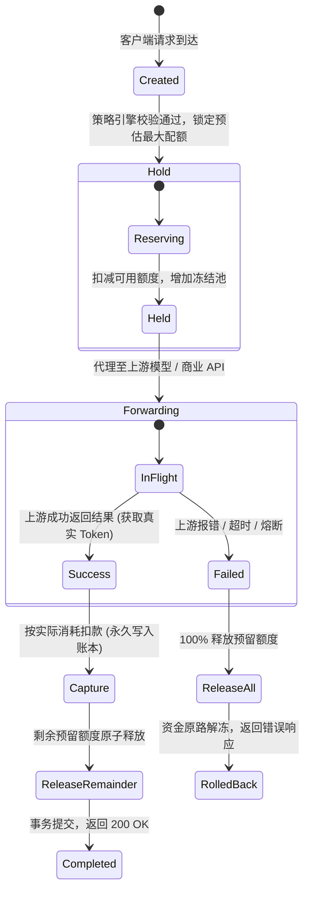

# AgentFinOps 企业级系统架构规范

> **版本**：v2.0.0 (企业级生产基线)  
> **核心定位**：**企业级 AI 行为审计与资金防火墙网关 (AI Agent Gateway & FinOps)**  
> **适用范围**：AgentFinOps 控制台、核心网关运行时 (`gateway`)、多语言 SDK 与企业基础设施

---

## 1. 概述与核心架构目标

**AgentFinOps** 是面向企业级大语言模型（LLM）与自主 AI Agent 打造的非托管金融级防护网关与成本治理平台。它架设在非确定性的大语言模型推理与确定性的外部资金、商业 API 资源之间，解决 AI 陷入死循环刷爆商业接口、部门预算分摊混乱、缺乏审计留痕等核心生产风险。

### 核心设计原则
1. **对 AI 自主行为零信任（Zero-Trust on AI）：** AI 模型只能提议调用，外部金钱扣减与网络放行严格发生在确定性的策略引擎边界之后。
2. **正交解耦的三态生命周期：** 将业务请求意图（PaymentIntent）、内部账本冻结与确认（Settlement: Hold/Capture/Release）与下游接口履约（Fulfillment）严格正交解耦，杜绝网络超时导致的资金悬挂。
3. **人在回路（Human-in-the-Loop, HITL）：** 单笔大额请求支持 402 异步挂起，自动向办公协作平台（飞书/企业微信/钉钉）推送富文本审批卡片，移动端一键放行。
4. **四级树状预算治理：** 租户（企业） $\to$ 事业群/部门 $\to$ 项目组 $\to$ 具体智能体，毫秒级级联校验与预算硬顶。
5. **只追加不可变账本（Append-Only Ledger）：** 资金变动流水一经生成严禁修改与删除，外部人民币分位按乘 10,000 转为 6 位微单位整数存储，严禁浮点数。

---

## 2. 系统全景拓扑与核心组件

```mermaid
graph TD
    subgraph ClientZone [客户端与 Agent 运行时 (Client Zone)]
        AgentApp[AI Agent 应用 / 业务系统]
        ClientSDK[AgentPay Client SDK<br/>(Python / TypeScript / Java)]
        LocalPolicy[端侧策略防护引擎<br/>(本地 RPM 熔断 / 单笔预检)]
        AgentApp --> LocalPolicy
        LocalPolicy --> ClientSDK
    end

    subgraph GatewayZone [核心网关数据面 (Gateway Core Zone)]
        Gateway[AgentPay Gateway (Go 极速核心)]
        Router[动态路由与 RCU 快照引擎]
        Firewall[金融防火墙与级联配额校验器]
        HITL[402 异步挂起与解挂引擎]
        StateMachine[防悬挂三态状态机<br/>(Hold / Capture / Release)]
        
        Gateway --> Router
        Gateway --> Firewall
        Gateway --> HITL
        Gateway --> StateMachine
    end

    subgraph AdminZone [控制面与财务管理 (Control & FinOps Zone)]
        Console[AgentFinOps Web 控制台 (Vue 3)]
        AdminAPI[企业管理 API 服务]
        BillingService[充值与发票清算服务]
        CollabBot[飞书 / 企微 / 钉钉审批机器人]
        LangfusePanel[Langfuse 联合链路追踪]
        
        Console --> AdminAPI
        AdminAPI --> BillingService
        HITL <--> CollabBot
    end

    subgraph PersistenceZone [持久化与外部依赖 (Persistence & Upstream)]
        Postgres[(PostgreSQL 15+ 权威存储<br/>组织树 / 虚拟账本 / 审计事件)]
        Redis[(Redis 7+<br/>分布式配额缓存 / 审批状态)]
        Upstream[上游模型与商业 API<br/>DeepSeek / 通义千问 / 企查查]
        
        Gateway --> Postgres
        Gateway --> Redis
        Gateway --> Upstream
    end

    ClientSDK -->|1. 发起 API 请求| Gateway
```

### 核心子系统与职责说明

| 组件模块 | 职责与技术实现 |
| :--- | :--- |
| **AgentPay Client SDK** | 语言级无侵入客户端（Python / TS / Java），拦截外部请求，在本地预检单笔上限与滑动窗口 RPM，支持 402 挂起自动轮询与重放。 |
| **Go Gateway Data Plane** | 高性能无锁反向代理核心，负责流式解析 LLM 响应（SSE Chunk），提取真实 Token 消耗，执行动态计费与配额原子扣减。 |
| **金融防火墙与策略引擎** | 执行四级树状级联校验：租户总余额 $\to$ 部门月度配额 $\to$ 项目组月度配额 $\to$ Agent 单笔/日预算，超限毫秒级阻断。 |
| **人在回路 (HITL) 引擎** | 请求金额落在 `[hitl_threshold, max_tx_cap]` 时返回 `402 Payment Required` 与 `approval_id`，异步向飞书/企微推送审批卡片。 |
| **虚拟钱包与账本引擎** | Append-Only 不可变复式记账流水，支持预扣（Hold）、实扣（Capture）与退回（Release），保证高并发下账本零误差。 |
| **企业管理控制台 (Console)** | 纯 Web 前端运营界面，提供组织架构管理、成员 RBAC、实时扣费流水监控、审批卡片配置与对账单/发票导出。 |

---

## 3. 防悬挂三态状态机规范 (Hold / Capture / Release)

在传统 API 网关中，上游超时或网络抖动极易引发“资金扣了但结果没拿到”或“结果拿到了但没扣费”的双向不一致。AgentFinOps 采用严格正交的**防悬挂三态状态机**：



1. **Hold（事前预冻结）**：
   网关在转发上游前，在数据库事务中对租户钱包加行级排他锁，执行：
   $$\text{available\_cache} \gets \text{available\_cache} - \Delta,\quad \text{held\_cache} \gets \text{held\_cache} + \Delta$$
2. **Capture（事后确认扣费）**：
   上游成功返回且流式响应结束，网关解析得到真实金额 $\text{ActualCost}$，写入 `ap_ledger_entry`（type=`capture`）：
   $$\text{held\_cache} \gets \text{held\_cache} - \Delta,\quad \text{available\_cache} \gets \text{available\_cache} + (\Delta - \text{ActualCost})$$
3. **Release（超时/异常完全释放）**：
   若上游发生 504 Gateway Timeout、500 报错或客户端主动断开，网关触发原子解冻，全额返还 $\Delta$：
   $$\text{held\_cache} \gets \text{held\_cache} - \Delta,\quad \text{available\_cache} \gets \text{available\_cache} + \Delta$$
   **系统在任何单点故障下绝无悬挂扣款风险。**

---

## 4. 安全信任边界与数据流隔离

```text
┌────────────────────────────────────────────────────────────────────────┐
│                        UNTRUSTED ZONE (非授信区域)                     │
│   • 外部用户输入、提示词 (Prompt)、大语言模型幻觉输出                  │
│   • 第三方无信用的未知 Agent 工具脚本                                  │
└───────────────────────────────────┬────────────────────────────────────┘
                                    │ HTTP 请求 (携带 API Key / Approval Id)
                                    ▼
┌────────────────────────────────────────────────────────────────────────┐
│                        TRUSTED ZONE (企业安全网关边界)                 │
│                                                                        │
│   ┌────────────────────────────────────────────────────────────────┐   │
│   │ 1. 身份与 RBAC 鉴权 (SHA-256 API Key 快速比对)                 │   │
│   │ 2. 金融防火墙策略预检 (单笔上限、日预算、滑动窗口 RPM 熔断)    │   │
│   │ 3. 树状配额级联校验 (租户 -> 部门 -> 项目 -> Agent)             │   │
│   │ 4. 人在回路 (HITL) 动态判定 (小额放行 / 中额审批 / 超额阻断)    │   │
│   │ 5. 原子三态记账引擎 (PostgreSQL 行级锁 Hold / Capture)         │   │
│   └────────────────────────────────────────────────────────────────┘   │
└───────────────────────────────────┬────────────────────────────────────┘
                                    │ 安全内网专线 / 集中托管密钥
                                    ▼
┌────────────────────────────────────────────────────────────────────────┐
│                     UPSTREAM RESOURCE (企业上游资源)                   │
│   • 商业大模型 (DeepSeek, 通义千问, 文心一言)                          │
│   • 高价值付费数据源 (企查查, 万方数据, 金融研报)                      │
└────────────────────────────────────────────────────────────────────────┘
```

- **Master Key 绝不下沉**：商业模型与付费数据源的真实 API Key 集中存储在网关后端（经 AES-256-GCM 或云端 KMS 加密），智能体应用仅持有 AgentPay 颁发的受控 API Key，杜绝凭证泄露。
- **内存零泄露**：网关运行于低权限独立服务，严禁向上游直接暴露企业数据库凭证。
