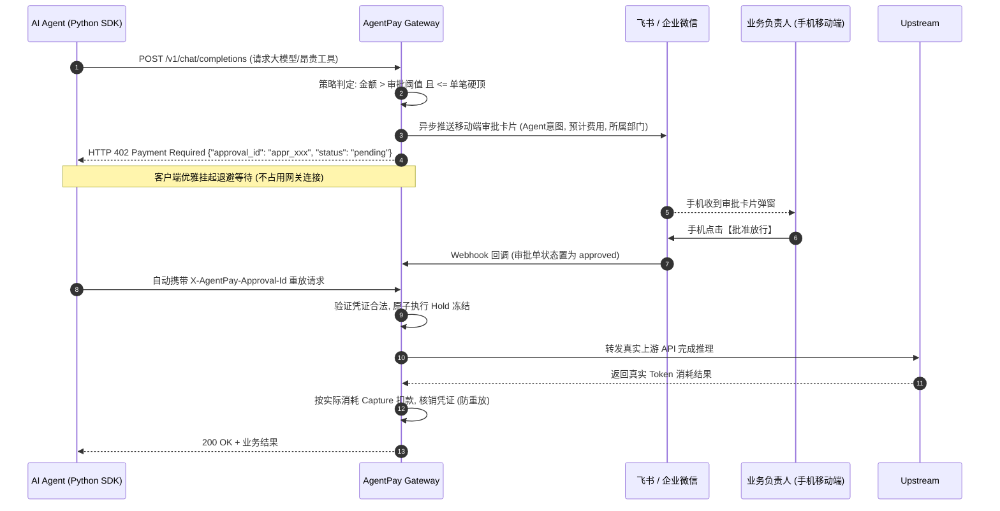

# 警惕！一个 Prompt 死循环刷爆 5 万元账单：为什么企业落地 AI Agent 必须架设“资金防火墙”？

> **作者**：杰哥AI运营  
> **首发平台**：微信公众号「杰哥AI运营」  
> **开源项目**：[Gitee 仓库](https://gitee.com/julywhj/AgentFinOps) | [GitHub 仓库](https://github.com/open-agentpay/AgentFinOps)  
> **适用读者**：AI 架构师、技术总监、大模型应用开发者、企业 FinOps 成本负责人

---

## 01. 引子：一场发生在周日凌晨的“账单惊吓”

上周，一位在某跨境电商独角兽担任 AI 负责人的朋友向我大倒苦水：

> “周日早晨醒来，手机被告警短信刷屏了。我们一个部署在生产环境的竞品价格监测 Agent，因为目标电商网站昨夜临时改版，解析报错。Agent 在 ReAct 思考循环中误判为‘重试获取上下文’，陷入了死循环……短短 6 个小时，以每秒数次的并发狂调付费搜索工具和商业大模型推理 API。直到云厂商账单告警触发停机，**一宿直接刷掉了 5.2 万元**！”

这绝不是个例。

随着大语言模型（LLM）从简单的“单轮问答”演进为具备**自主规划、工具调用、长期记忆与环境交互能力**的**自主智能体（Autonomous Agent）**，企业正享受到前所未有的自动化红利。

然而，**自主性（Autonomy）是一把锋利的双刃剑**：
- 传统的 Web 接口调用，频次取决于前端**真实人类**的点击操作，流量可预估、有上限；
- 而 AI Agent 拥有“自主思考与自我循环”的权力。**一旦 Prompt 产生幻觉、工具入参异常或解析失败，它会在毫无察觉的情况下，在几分钟内发起成千上万次高昂的外部消费。**

企业落地 AI Agent，正在经历从“技术可行性验证”到“财务安全失控”的阵痛。

---

## 02. 痛点深挖：传统网关与监控工具为什么束手无策？

很多技术负责人可能会问：我们内网已经有了微服务 API 网关（如 Kong、APISIX、Nginx），也有了 LLM 可观测工具（如 Langfuse、LangSmith），难道还不够吗？

答案是：**完全不够。因为它们的关注点根本不在“资金风控”上。**

```text
┌────────────────────────────────────────────────────────────────────────────────────────┐
│                                 企业 AI 运行时治理的断层                                │
│                                                                                        │
│   传统 API 网关 (Kong / APISIX)       LLM 可观测性 (Langfuse)        AgentFinOps (资金防火墙) │
│   ─────────────────────────          ───────────────────────        ──────────────────────── │
│   • 仅看 HTTP 次数 (QPS / RPM)        • 负责“大脑监控”               • 负责“双手与钱包防火墙” │
│   • 不懂 Token 流式消耗与单价        • Prompt 链路回溯与质量打分    • 单笔/日/月预算硬顶熔断 │
│   • 无法区分 Agent 意图与工具单价    • 擅长事后分析，缺乏事中拦截   • 飞书/企微人在回路 (HITL)│
│   • 无财务层级（部门/项目配额）      • 无法与企业财务和对公账本打通 • 402 异步挂起防连接池耗尽 │
└────────────────────────────────────────────────────────────────────────────────────────┘
```

### 1. 传统 API 网关不懂“Token 计量与动态单价”
传统网关的限流仅停留在“每分钟最多 100 次请求（RPM）”。但在大模型世界里，一次调用消耗 500 个 Token 和一次调用带几十页 PDF 消耗 128k Token，成本相差数百倍！传统网关无法针对动态价格实施精准限额。

### 2. LLM 可观测工具是“大脑监控器”，缺乏“事中刹车皮”
Langfuse 和 LangSmith 非常优秀，能清晰记录 Agent 的调用链（Trace）与提示词。但它们是**旁路异步上报**的监控系统——当你在 Langfuse 看板上看到 Agent 产生异常 Token 消耗时，账单早已产生，木已成舟。

### 3. 多部门成本分摊一团烂账
企业内部通常只有一个或几个全局 Master API Key。到了月底，财务拿着几万、十几万元的总账单质问：“产研事业部、运营中心、客服团队各自消耗了多少？”技术部门只能两手一摊。缺乏自上而下的树状配额切分体系。

### 4. 缺乏事中兜底：“要么全放行，要么全拦截”
如果一刀切地在代码里把阈值设死，Agent 在处理正常的大额关键业务（例如：汇总季度财务年报、采购昂贵行业数据）时就会频繁报错，直接阻断业务进行。

**企业真正需要的，是一套具备“人在回路（Human-in-the-Loop, HITL）”的弹性风控梯度。**

---

## 03. 架构解法：AgentPay 企业级资金防火墙设计范式

为了彻底解决上述痛点，国内开源项目 **AgentPay (AgentFinOps)** 提出了一套全新的治理范式：**架设在“AI 智能与推理”与“外部资金/商业 API”之间的企业级金融防火墙与三态状态机**。

```text
                               ┌────────────────────────────────────────────────────────┐
                               │       AgentPay: 企业级 AI 行为审计与资金防火墙网关       │
                               └───────────────────────────┬────────────────────────────┘
              ┌────────────────────────────┬───────────────┴───────────────┬────────────────────────────┐
              ▼                            ▼                               ▼                            ▼
     【模块一：企业内控与安全】      【模块二：FinOps与财务闭环】    【模块三：微支付与协议引擎】     【模块四：生态联动与观测】
     • 飞书/企微/钉钉 HITL 审批      • 4级组织树状预算切分           • HTTP 402/x402 异步挂起         • 与 Langfuse 深度联动共生
     • 移动端一键放行与凭证核销      • 微信/支付宝/对公预付充值      • 防悬挂三态机 (Hold/Capture)   • MCP 协议原生支付中间件
     • 行为异动实时检测与告警        • 6位微单位无浮点数存储         • RCU 高性能动态热更新路由       • Python / TS / Java SDK
     • 单笔硬顶与滑动窗口限额        • 内部只追加流水对账单          • 10,000+ 并发毫秒级路由代理     • Spring Boot Starter 驱动
```

### 核心机制 1：三级风控梯度与 HTTP 402 异步挂起

AgentPay 将每一笔工具调用或模型请求划分为三个风险等级：

1. **小额极速通道（金额 $\le$ 阈值，如 $\le 10$ 元）**：本地毫秒级判定放行，无感执行；
2. **中大额审批通道（$10$ 元 $<$ 金额 $\le 500$ 元）**：
   - 网关返回标准的 **`HTTP 402 Payment Required`**，响应体携带 `approval_id`；
   - **立即断开 HTTP 连接，绝不占用长连接，彻底防止几分钟的人工审批耗尽网关连接池**；
   - 后台异步向负责人的**飞书 / 企业微信 / 钉钉**推送富文本审批卡片；
   - 负责人在手机移动端点击【批准放行】；
   - 客户端 SDK 探测到批准结果后，自动携带凭证重放，网关原子执行扣款放行！
3. **超大额熔断通道（金额 $> 500$ 元）**：超出单笔硬顶，系统直接拒绝（`SINGLE_TX_CAP_EXCEEDED`）并触发异动告警。



### 核心机制 2：四级树状成本中心与级联配额硬顶

AgentPay 实现了对齐企业真实组织架构的四级配额切分：
$$\text{企业（租户）} \longrightarrow \text{事业群/部门} \longrightarrow \text{业务项目组} \longrightarrow \text{具体 Agent}$$

任何一笔请求扣款，必须在毫秒级同时穿透校验：
- **Agent 级别**：是否超过单笔上限与 24h 滑动窗口？
- **项目级别**：是否超过该项目月度预算上限？
- **部门级别**：是否超过其归属部门（及各级上级事业群）的月度预算硬顶？
- **企业级别**：企业总预付钱包账户余额是否充足？

**只要任一层级超限，立即阻断并上报指标，彻底解决“多部门成本分摊烂账”与“层级失控”。**

### 核心机制 3：防悬挂三态资金状态机 (Hold $\to$ Capture $\to$ Release)
在网络超时或上游服务异常时，很多自研计费系统经常出现“钱扣了但推理失败”或“推理成功但未入账”的悬挂故障。AgentPay 引入了金融级的预授权三态设计：
- **Hold（预冻结）**：调用前根据预估上限原子锁定额度；
- **Capture（确认扣款）**：上游成功返回真实 Token 消耗后，按实际发生额结算入账；
- **Release（释放多余预留）**：若发生网络超时、调用失败或实际消耗小于预估，系统自动将预留资金无损退回钱包。

### 核心机制 4：纯正国内合规法币闭环（零加密货币风险）
与海外 Web3 类的实验性支付协议不同，AgentPay 专为国内企业合规设计：
- **无加密货币，无海外牌照风险**：资金进出国内对公银行账户与企业微信/支付宝收银台，兑换为企业内部不可提现、不可跨租户互转的虚拟账本；
- **6 位微单位无浮点数运算**：在入账边界严格执行：
  $$\text{amount\_base\_units} = \text{payment\_minor\_amount} \times 10,000$$
  （即 1 元人民币 = 1,000,000 微单位），全程以 `int64` 整数存储运算，彻底杜绝浮点数精度偏差与溢出风险。

---

## 04. 动手实操：5 分钟给你的智能体挂上资金防火墙

AgentPay 已经全面开源并发布了 Docker Compose 一键启动包与 Python / TypeScript 官方 SDK。

### 步骤 1：本地或服务器一键拉起网关

```bash
# 1. 克隆国内 Gitee 镜像仓库
git clone https://gitee.com/julywhj/AgentFinOps.git
cd AgentFinOps

# 2. 拷贝环境配置文件并一键启动
cp .env.example .env
docker compose up -d
```

启动完成后，即可在本地打开企业级控制台：
- **控制台地址**：`http://localhost:8080`
- **网关代理入口**：`http://localhost:8000`

在控制台中，你可以直观配置组织部门、设定月度预算硬顶、关联飞书 Webhook 机器人并查看每一笔 Agent 消费审计流。

### 步骤 2：在 Python 代码中无缝接入（仅需 3 行）

通过 pip 安装官方核心 SDK：
```bash
pip install agentpay-core-sdk
```

在你的 Agent 工具调用或推理代码中接入：

```python
from agentpay_core import AgentPayClient

# 1. 初始化客户端，指定防火墙网关地址与 API Key
client = AgentPayClient(
    gateway_url="http://localhost:8000",
    api_key="apk_test_secret_key_123456",
    auto_poll_hitl=True  # 核心开关：遇到大额 402 审批自动进入友好等待，手机放行后自动重试
)

# 2. 正常发起大模型推理或高价值工具调用
try:
    response = client.post(
        path="/v1/chat/completions",
        json={
            "model": "deepseek-r1",
            "messages": [
                {"role": "user", "content": "请针对 2026 年 Q4 财报执行深度全网数据检索与财务合规审计分析"}
            ]
        }
    )
    print("推理成功完成，结果：", response.json())
except Exception as e:
    print("请求被资金防火墙拦截，原因：", e)
```

**运行效果**：
- 如果该请求消耗金额 $\le 10$ 元，程序以毫秒级极速返回结果；
- 如果该请求预计消耗 50 元，触发中额审批：
  - 控制台日志打印：`[AgentPay] Transaction requires human approval (approval_id: appr_01hxxx). Waiting for approver decision...`；
  - 负责人的**飞书/企业微信**即刻收到富文本审批卡片；
  - 负责人点击【批准】后，客户端自动重放，成功获取最终结果！

---

## 05. 总结与展望

在生成式 AI 狂飙突进的今天，**“能跑通 Demo”已经不再是衡量企业 AI 实力的门槛，“能在生产环境安全、可控、低成本地跑通业务”才是商业化落地的生死线。**

传统 API 网关守卫的是“网络边界”，而以 AgentPay 为代表的**企业级 AI 行为审计与资金防火墙**，守卫的则是智能时代企业的**“财务底线与决策安全”**。

---

## 🎁 读者福利与交流入群

本项目现已在 **Gitee** 与 **GitHub** 全面开源，欢迎各位架构师与开发者体验、共建与提出宝贵建议！

- 🇨🇳 **Gitee 官方开源仓库**：  
  👉 [https://gitee.com/julywhj/AgentFinOps](https://gitee.com/julywhj/AgentFinOps) （求个 Star ⭐️）
- 🌐 **GitHub 官方开源仓库**：  
  👉 [https://github.com/open-agentpay/AgentFinOps](https://github.com/open-agentpay/AgentFinOps)
- 📖 **官方技术与架构文档中心**：  
  👉 [https://aipmedia.cn/docs/](https://aipmedia.cn/docs/)

---

### 加入「AI Agent 架构师与 FinOps 技术交流群」

为了帮助大家更好地在企业生产环境中落地智能体风控与成本治理，我们建立了专属微信技术交流群：
- **第一手开源版本动态与企业实践案例分享**；
- **核心开发团队在线答疑与架构咨询**；
- **免费领取《企业级 AI 行为审计与资金防火墙落地方案白皮书》PDF 完整版**。

👇 **入群方式**：  
1. 扫描关注微信公众号：**「杰哥AI运营」**；  
2. 添加社区助理微信：**`jie125846`**，添加时请备注：**「智能体防火墙」**，助理将第一时间拉您入群交流！  
3. 技术与商务合作邮箱：**`julywhj@163.com`**。

---
*(本文欢迎各大技术社区规范转载，转载请注明出处与开源仓库链接。)*
