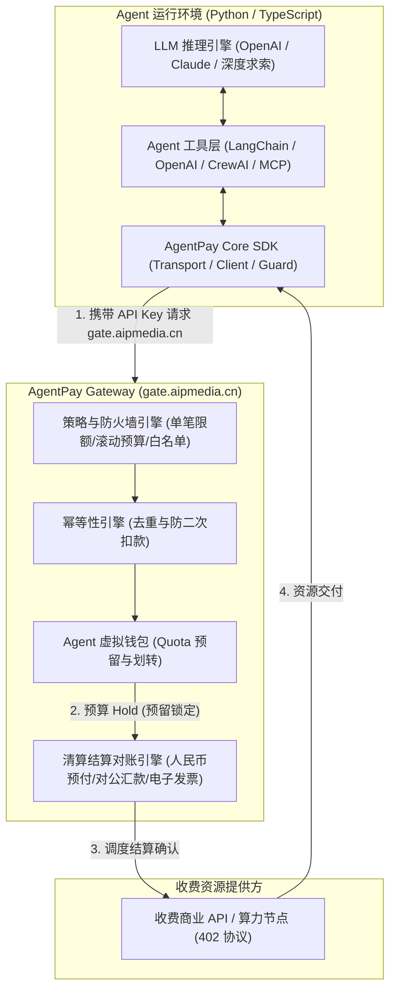
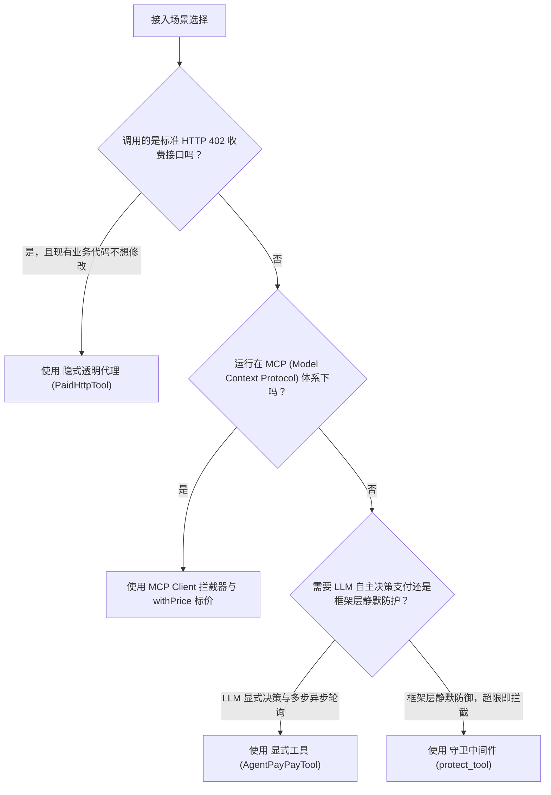
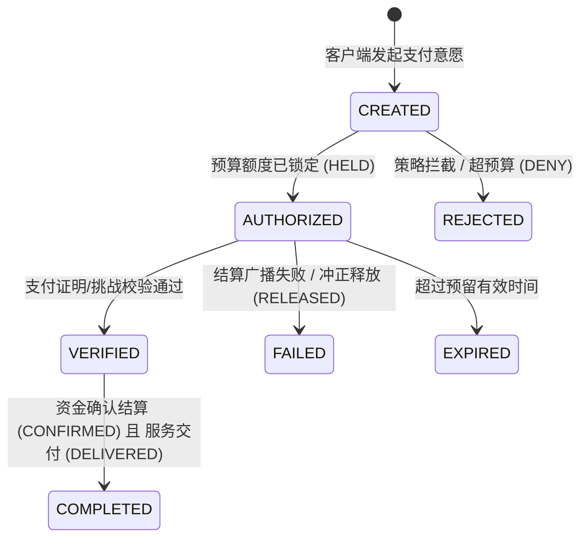

# AI Harness 与 Agent 框架集成指南 (LangChain / OpenAI / CrewAI)

> **版本**：v1.0.0  
> **适用框架**：LangChain / LangGraph、OpenAI Agents SDK / Function Calling、CrewAI、MCP (Model Context Protocol)  
> **支持语言**：Python 3.10+、TypeScript / JavaScript (Node.js 18+)  
> **网关统一接入地址**：`https://gate.aipmedia.cn`

---

## 目录
1. [系统架构与设计理念](#1-系统架构与设计理念)
2. [不同接入方式的对比与选型矩阵](#2-不同接入方式的对比与选型矩阵)
3. [三域状态机生命周期模型详解](#3-三域状态机生命周期模型详解)
4. [核心使用场景与端到端实战](#4-核心使用场景与端到端实战)
   - [场景一：同步按次计费 API（隐式 402 代理模式）](#场景一同步按次计费-api隐式-402-代理模式)
   - [场景二：显式意图付费与异步结算轮询（LangChain / LangGraph）](#场景二显式意图付费与异步结算轮询langchain--langgraph)
   - [场景三：OpenAI Agents SDK 原生函数与守卫保护](#场景三openai-agents-sdk-原生函数与守卫保护)
   - [场景四：CrewAI 多 Agent 隔离协同支付](#场景四crewai-多-agent-隔离协同支付)
   - [场景五：MCP (Model Context Protocol) 协议级拦截与计费](#场景五mcp-model-context-protocol-协议级拦截与计费)
5. [常见错误码与异常处理对照表](#5-常见错误码与异常处理对照表)
6. [生产环境最佳实践与安全注意事项](#6-生产环境最佳实践与安全注意事项)

---

## 1. 系统架构与设计理念

AgentPay 是架设在企业大模型推理层（LLM Harness）与外部商业收费资源之间的**金融级安全与行为审计防火墙**。它解决了 AI Agent 在自主调用外部付费资源（如商用数据接口、企业企查查/天眼查通道、专业研报、GPU 云算力）时的三大核心痛点：

1. **防止模型失控扣费（Fail-Closed 防火墙）**：设置单笔交易上限（Single Tx Cap）、24 小时滚动预算（Rolling 24h Budget）与高频循环熔断（Circuit Breaker）。
2. **凭据与私钥隔离（Zero Key in LLM Context）**：Agent 执行环境与 LLM 上下文中严禁暴露底层资金支付私钥或高危银行凭证，仅持有细粒度权限管控的 `Agent API Key`。
3. **三域解耦与跨网络异步长任务对账**：将**业务支付意图（Payment Intent）**、**资金沉降对账（Settlement）**与**上游服务交付（Fulfillment）**完全解耦，支持即时扣款与长时间异步对账平账。



---

## 2. 不同接入方式的对比与选型矩阵

AgentPay 针对不同的框架生态与交互模式，提供了四种接入方式：

| 接入方式 | 适用场景 | 模型感知度 (LLM Awareness) | 延迟开销 | 实现机制 | 典型代表 |
| :--- | :--- | :---: | :---: | :--- | :--- |
| **1. 隐式透明代理<br>(Transparent HTTP 402)** | 纯 REST/HTTP 接口访问；现有业务代码零改动；Agent 像访问普通免费接口一样调用即可。 | **完全无感**<br>(零 Prompt Token 消耗) | 极低（协议级透明协商重试） | SDK 在 HTTP 传输层自动捕获 `402 Payment Required`，并在后台自动完成授权重放。 | `PaidHttpTool`<br>`AgentPayTransport` |
| **2. 显式意图工具<br>(Explicit Tools)** | 复杂多步推理；大额支付；需要向用户显式确认；需长时间轮询异步任务状态。 | **高度感知**<br>(模型显式决策调用) | 中（增加一轮模型推理） | 注册 `agentpay_pay` 与 `agentpay_get_payment` 工具，模型根据价格决策是否支付并轮询。 | `AgentPayPayTool`<br>`get_openai_tools` |
| **3. 守卫中间件<br>(Pre-Execution Guard)** | 内部已有执行工具（如云资源开通、数据库写入），需在工具执行前执行硬性预算与权限拦截。 | **拦截时感知**<br>(拒绝时向模型抛出指导) | 极低（本地/远程轻量 Dry-run 预检） | 在工具执行入口处执行拦截检查，策略 `DENY` 或超预算时以 Fail-Closed 阻断下游调用。 | `protect_tool`<br>`protect_openai_function` |
| **4. MCP 拦截器<br>(MCP Interceptor)** | Anthropic Model Context Protocol 协议架构生态；跨进程或跨 RPC 工具计费。 | **部分感知**<br>(基于 Schema 注入价格元数据) | 低 | 在 Client 发起 `tools/call` 前解析 `@withPrice` 元数据，经预留（Reserve）后提交。 | `MCP Client Interceptor`<br>`InMemoryToolQuotaGuard` |

### 选型决策流程图



---

## 3. 三域状态机生命周期模型详解

AgentPay 规范弃用了传统支付中简单的 `SUCCESS / FAILED` 二元状态，引入了**三域正交解耦状态机**：

1. **业务意图域 (`PaymentIntentStatus`)**：代表当前支付单的整体业务推进进度。
2. **资金结算域 (`SettlementStatus`)**：代表实际虚拟钱包额度或企业财务账本的资金扣减状态。
3. **服务交付域 (`FulfillmentStatus`)**：代表上游收费数据源或服务是否实际交付给 Agent。



### 状态值与推荐动作速查表

| 域名 | 状态枚举 | 含义解释 | 推荐下一步动作 (`next_action`) |
| :--- | :--- | :--- | :--- |
| **PaymentIntent** | `CREATED` | 支付意图已创建，正在等待策略评估。 | `POLL_STATUS` |
| | `AUTHORIZED` | 财务防火墙放行，虚拟钱包额度已被原子锁定（Hold）。 | `POLL_STATUS` / 准备接收交付 |
| | `COMPLETED` | 资金沉降完成且服务已交付，交易闭环。 | `NONE` |
| | `REJECTED` | 单笔或 24h 预算超限，被策略拒绝，未产生资金扣减。 | `REQUEST_BUDGET_APPROVAL` / `STOP` |
| **Settlement** | `HELD` | 虚拟钱包 Quota 已锁定，尚未最终扣除。 | `POLL_STATUS` |
| | `PENDING` | 结算单正在财务通道中清算确认中。 | `POLL_STATUS` (使用指数退避) |
| | `CONFIRMED` | 资金已不可逆扣除完成。 | `NONE` |
| | `UNKNOWN` | 遇到网络超时或通讯异常，状态不确定。**严禁重新发起新支付！** | 必须使用原始 `payment_intent_id` 继续轮询 |
| **Fulfillment** | `NOT_STARTED` | 上游尚未开始处理交付。 | `POLL_STATUS` |
| | `PROCESSING` | 上游算力或服务正在异步生成中（如深度研报合成、文生视频）。 | `POLL_STATUS` |
| | `DELIVERED` | 数据/服务已完整交付给调用端。 | `NONE` |
| | `RECOVERY_REQUIRED`| 资金已扣但交付失败，需进入自动冲正流程。 | `WAIT_ADMIN_REVIEW` |

---

## 4. 核心使用场景与端到端实战

### 场景一：同步按次计费 API（隐式 402 代理模式）

**场景描述**：  
Agent 需要调用收费的天气专业数据 API。该接口返回 HTTP 402，并携带付款挑战。开发者希望**完全不修改业务调用代码**，由底层的 Transport 拦截器自动协商支付。

#### Python 实现
```python
import os
from agent_core.client.client import AgentPayClient
from agent_core.policy.models import PolicyConfig
from agent_core.policy.sqlite_engine import SQLitePolicyEngine

# 1. 配置本地安全策略引擎（Fail-Closed 规则，单笔限额与24小时滚动预算）
policy = SQLitePolicyEngine.create_in_memory(
    PolicyConfig(
        id="weather_agent_policy",
        max_per_tx_base_units=500_000,          # 单笔最大 0.50 元/点数 (6位微单位: 500,000)
        rolling_budget_24h_base_units=5_000_000,# 24小时累计预算 5.00 元/点数
        whitelist_domains={"api.weather.com"},  # 白名单域名防护
    )
)

# 2. 实例化 AgentPayClient（统一连接 gate.aipmedia.cn）
client = AgentPayClient(
    api_key=os.environ["AGENTPAY_API_KEY"],
    policy=policy,
    base_url="https://gate.aipmedia.cn",
)

# 3. 发起普通 GET 请求。当遇到 402 时，Transport 会自动完成鉴权预扣并重试获取数据
response = client.get("https://api.weather.com/v1/forecast?city=Beijing")
print("Response Status:", response.status_code)
print("Weather Data:", response.json())
```

#### TypeScript 实现
```typescript
import { AgentPayClient, SQLitePolicyEngine, PolicyConfig } from '@open-agentpay/sdk';

const policy = SQLitePolicyEngine.createInMemory(
  new PolicyConfig({
    id: 'weather_agent_policy',
    maxPerTxBaseUnits: 500_000n,          // 单笔上限 0.50
    rollingBudget24hBaseUnits: 5_000_000n, // 24小时滚动上限 5.00
    whitelistDomains: ['api.weather.com'],
  })
);

const client = new AgentPayClient({
  apiKey: process.env.AGENTPAY_API_KEY,
  policy,
  baseUrl: 'https://gate.aipmedia.cn',
});

// 透明发起请求，底层自动处理 402 挑战签名与重试
const response = await client.fetch('https://api.weather.com/v1/forecast?city=Beijing');
const weatherData = await response.json();
console.log('Weather Data:', weatherData);
```

---

### 场景二：显式意图付费与异步结算轮询（LangChain / LangGraph）

**场景描述**：  
在多步推理中，Agent 面对一个需要付费 2.00 元的高级金融深度分析数据源。大模型通过调用 `agentpay_pay` 主动发起支付，获取 `payment_intent_id`；若结算尚未完成（状态为 `PENDING`），模型调用 `agentpay_get_payment` 轮询直至成功。

#### Python 实现
```python
import os
from langchain_openai import ChatOpenAI
from langchain.agents import AgentExecutor, create_openai_tools_agent
from langchain_core.prompts import ChatPromptTemplate, MessagesPlaceholder
from agent_core.client.client import AgentPayClient
from agent_core.integrations.langchain import get_agentpay_tools
from agent_core.policy.models import PolicyConfig
from agent_core.policy.sqlite_engine import SQLitePolicyEngine

# 1. 初始化客户端
client = AgentPayClient(
    api_key=os.environ["AGENTPAY_API_KEY"],
    base_url="https://gate.aipmedia.cn",
    policy=SQLitePolicyEngine.create_in_memory(PolicyConfig(
        id="langchain_agent_policy",
        max_per_tx_base_units=5_000_000, # 单笔上限 5.00 元/点数
        rolling_budget_24h_base_units=20_000_000,
        whitelist_domains={"*"},
    )),
)

# 2. 提取标准 AgentPay LangChain 工具集
# 包含：AgentPayPayTool (agentpay_pay) 与 AgentPayGetPaymentTool (agentpay_get_payment)
pay_tools = get_agentpay_tools(client)

# 3. 组装 LangChain Agent
llm = ChatOpenAI(model="gpt-4o", temperature=0)
prompt = ChatPromptTemplate.from_messages([
    ("system", "你是一名智能商业分析助手。当需要调用付费数据源时，请使用 agentpay_pay 发起支付；若结算尚未完成，请使用 agentpay_get_payment 轮询直到完成交付。"),
    ("human", "{input}"),
    MessagesPlaceholder(variable_name="agent_scratchpad"),
])

agent = create_openai_tools_agent(llm, pay_tools, prompt)
agent_executor = AgentExecutor(agent=agent, tools=pay_tools, verbose=True)

# 4. 执行推理任务
result = agent_executor.invoke({
    "input": "请帮我购买一份 financial_market_depth 报告，单笔报价 0.50 元。"
})
print("Agent 输出结果:", result["output"])
```

#### TypeScript 实现
```typescript
import { AgentPayClient, getAgentPayTools, SQLitePolicyEngine, PolicyConfig } from '@open-agentpay/sdk';

const client = new AgentPayClient({
  apiKey: process.env.AGENTPAY_API_KEY,
  baseUrl: 'https://gate.aipmedia.cn',
  policy: SQLitePolicyEngine.createInMemory(new PolicyConfig({
    id: 'ts_langchain_policy',
    maxPerTxBaseUnits: 5_000_000n,
    rollingBudget24hBaseUnits: 20_000_000n,
    whitelistDomains: ['*'],
  })),
});

// 获取 [createAgentPayPayTool, createAgentPayGetPaymentTool]
const tools = getAgentPayTools(client);
console.log(`已加载 ${tools.length} 个 AgentPay 显式工具:`, tools.map(t => t.name));
```

---

### 场景三：OpenAI Agents SDK 原生函数与守卫保护

**场景描述**：  
直接使用 OpenAI 原生 Function Calling API 时，希望：
1. 模型具备主动支付与查询的能力；
2. 为一个本地高成本方法（例如 `run_gpu_training`）增加前置守卫：在调用该方法前自动执行策略预检（Dry-run），超预算时直接抛出 `AgentPayPolicyDeniedError`，阻止该方法被触发。

#### Python 实现
```python
import os
import json
from openai import OpenAI
from agent_core.client.client import AgentPayClient
from agent_core.integrations.openai import (
    get_openai_tools,
    handle_openai_tool_call,
    protect_openai_function,
)
from agent_core.policy.models import PolicyConfig
from agent_core.policy.sqlite_engine import SQLitePolicyEngine

client = AgentPayClient(
    api_key=os.environ["AGENTPAY_API_KEY"],
    base_url="https://gate.aipmedia.cn",
    policy=SQLitePolicyEngine.create_in_memory(PolicyConfig(
        id="openai_policy",
        max_per_tx_base_units=10_000_000,
        rolling_budget_24h_base_units=50_000_000,
        whitelist_domains={"*"},
    )),
)

# 1. 定义受守卫保护的本地高开销算力函数（预估开销 2.50 元）
@protect_openai_function(resource_id="gpu_h100_cluster", client=client, amount="2.50")
def run_gpu_training(model_name: str, epochs: int) -> str:
    # 只有当策略评估为 ALLOW 时，该业务函数才会被实际调用
    return f"模型 {model_name} 在集群上成功启动训练 {epochs} 轮！"

# 2. 结合 OpenAI 原生调用
openai = OpenAI()
tools = get_openai_tools()

response = openai.chat.completions.create(
    model="gpt-4o",
    messages=[{"role": "user", "content": "请为 resource_id='gpu_h100_cluster' 支付 2.50 元"}],
    tools=tools,
)

# 3. 优雅分发与消息响应
choice = response.choices[0].message
if choice.tool_calls:
    for tool_call in choice.tool_calls:
        # handle_openai_tool_call 会捕获超额异常并转化为 LLM 可理解的友善提示
        tool_msg = handle_openai_tool_call(tool_call, client)
        print("工具执行结果返回给 OpenAI:", tool_msg)
```

#### TypeScript 实现
```typescript
import {
  AgentPayClient,
  getOpenAITools,
  handleOpenAIToolCall,
  protectOpenAIFunction,
  SQLitePolicyEngine,
  PolicyConfig,
} from '@open-agentpay/sdk';

const client = new AgentPayClient({
  apiKey: process.env.AGENTPAY_API_KEY,
  baseUrl: 'https://gate.aipmedia.cn',
  policy: SQLitePolicyEngine.createInMemory(new PolicyConfig({
    id: 'ts_openai_policy',
    maxPerTxBaseUnits: 10_000_000n,
    rollingBudget24hBaseUnits: 50_000_000n,
    whitelistDomains: ['*'],
  })),
});

// 使用 protectOpenAIFunction 包装高成本函数
const safeExecuteTask = protectOpenAIFunction(
  async (taskId: string) => {
    return `执行高成本任务: ${taskId}`;
  },
  {
    resourceId: 'expensive_task',
    client,
    amount: '1.20',
  }
);
```

---

### 场景四：CrewAI 多 Agent 隔离协同支付

**场景描述**：  
在多 Agent 协同体系中（如“信息检索员 Researcher”负责找数据，“财务分析师 Analyst”负责总结），通常**只需给负责对外拉取数据的 Researcher 赋予付款权限**，而 Analyst 无权动用资金。

#### Python 实现
```python
import os
from crewai import Agent, Crew, Task
from agent_core.client.client import AgentPayClient
from agent_core.integrations.crewai import get_crewai_tools
from agent_core.policy.models import PolicyConfig
from agent_core.policy.sqlite_engine import SQLitePolicyEngine

client = AgentPayClient(
    api_key=os.environ["AGENTPAY_API_KEY"],
    base_url="https://gate.aipmedia.cn",
    policy=SQLitePolicyEngine.create_in_memory(PolicyConfig(
        id="crew_policy",
        max_per_tx_base_units=1_000_000,
        rolling_budget_24h_base_units=5_000_000,
        whitelist_domains={"*"},
    )),
)

# 1. 仅为 Researcher 分配支付工具
researcher_tools = get_crewai_tools(client)

researcher = Agent(
    role="Senior Market Researcher",
    goal="搜集行业最新研报，遇到收费接口时在授权限额内自主支付获取。",
    backstory="你是一名专业的信息检索专家，持有细粒度权限管控的 AgentPay 商业支付权限。",
    tools=researcher_tools,
    verbose=True,
)

# 2. Analyst 无支付工具（实现权限最小化安全隔离）
analyst = Agent(
    role="Lead Financial Analyst",
    goal="汇总 Researcher 收集到的原始数据并生成结论报告。",
    backstory="你是一名资深财务分析专家，仅负责纯逻辑推理，无资金动用权限。",
    tools=[],
    verbose=True,
)

task1 = Task(
    description="获取 resource_id='sec_filings_pro' 的数据并支付 0.20 元。",
    expected_output="结构化企业财务原始数据",
    agent=researcher,
)

task2 = Task(
    description="分析 task1 获取的数据并生成一页总结研报。",
    expected_output="Markdown 格式分析研报",
    agent=analyst,
)

crew = Crew(agents=[researcher, analyst], tasks=[task1, task2], verbose=True)
crew.kickoff()
```

---

### 场景五：MCP (Model Context Protocol) 协议级拦截与计费

**场景描述**：  
在 Anthropic Claude Desktop 或企业自建 MCP 架构中，收费服务方通过 `@withPrice` 声明工具价格，调用端在工具 RPC 调用发出前自动拦截、预留配额并在调用结束后安全提交。

#### TypeScript 实现
```typescript
import {
  withPrice,
  ToolPricingMeta,
  InMemoryToolQuotaGuard,
  createMcpClientPreCallInterceptor,
} from '@open-agentpay/sdk';

// 1. MCP Server 端：声明工具价格与资产代码
const pricing: ToolPricingMeta = {
  pricePerCall: '0.10',
  asset: 'CNY',
  chargingMode: 'per_call',
  resourceId: 'enterprise_credit_search',
};

const rawSearchTool = {
  name: 'enterprise_search',
  description: '查询权威企业工商与司法风险信息。',
  parameters: { type: 'object', properties: { companyName: { type: 'string' } } },
};

// 注入价格元数据到 MCP Tool 描述中
const billableTool = withPrice(rawSearchTool, pricing);

// 2. MCP Client 端：前置配额守卫与拦截器
const guard = new InMemoryToolQuotaGuard({
  maxPerCall: 0.50,
  dailyBudget: 5.00,
});

const interceptor = createMcpClientPreCallInterceptor({ guard });

// 模拟 Client 调用前拦截：
// evaluate -> reserve -> commit/release 完整生命周期
const check = await interceptor.beforeCall({
  toolName: 'enterprise_search',
  pricingMeta: billableTool._agentpay_meta,
});

if (check.allowed) {
  try {
    console.log("配额预留成功，执行调用...");
    await interceptor.afterCallSuccess({ reservationId: check.reservationId });
  } catch (err) {
    // 调用发生异常崩溃，自动释放预留配额，避免企业资金损失
    await interceptor.afterCallFailure({ reservationId: check.reservationId, error: err });
  }
} else {
  console.error("MCP 工具调用被拦截:", check.reason);
}
```

---

## 5. 常见错误码与异常处理对照表

当触发网关拦截或网络故障时，SDK 会抛出结构化的 `AgentPayIntegrationError` 派生异常：

| 错误码 (`error_code`) | 抛出的异常类 (Python / TS) | 产生原因 | 应对与恢复策略 (`next_action`) |
| :--- | :--- | :--- | :--- |
| `UNAUTHENTICATED`<br>(401) | `AgentPayAuthenticationError` | 缺少 API Key 或 Key 已被管理员注销/撤销。 | `PROVIDE_API_KEY`<br>检查环境变量 `AGENTPAY_API_KEY` 是否有效。 |
| `POLICY_DENIED`<br>(403) | `AgentPayPolicyDeniedError` | 请求的路由、域名或操作未被当前 Agent 的白名单所允许。 | `STOP`<br>通知管理员在管理后台开通该商业资源权限。 |
| `BUDGET_EXCEEDED`<br>(403) | `AgentPayBudgetExceededError` | 单笔交易金额超过上限，或 24 小时累计消费达到上限。 | `REQUEST_BUDGET_APPROVAL`<br>提示模型向人类审批提额，或在策略中心提高阈值。 |
| `IDEMPOTENCY_CONFLICT`<br>(409) | `AgentPayIdempotencyConflictError` | 相同的 `idempotency_key` 正在处理中或参数与前次不一致。 | `POLL_STATUS`<br>不要换 Key 重新提交，使用原 Key 轮询现有支付单。 |
| `RATE_LIMITED`<br>(429) | `AgentPayRateLimitedError` | 每分钟调用频次（RPM）超出设定的安全阈值。 | `BACKOFF`<br>使用随机抖动指数退避，暂停请求。 |
| `CIRCUIT_OPEN`<br>(503) | `AgentPayCircuitOpenError` | Agent 陷入快速递归死循环，安全熔断器被触发。 | `STOP`<br>强制中断 Agent 执行链，保护钱包余额。 |
| `RECOVERY_REQUIRED` | `PaymentResult.requires_recovery()` | 资金已扣除，但上游服务交付超时或崩溃。 | `WAIT_ADMIN_REVIEW`<br>联系人工或等待自动冲正任务对账，严禁自动重复扣款。 |

---

## 6. 生产环境最佳实践与安全注意事项

> [!IMPORTANT]
> **1. 严禁使用 IEEE 754 浮点数计算金额**  
> 在所有调用参数中，金额 `amount` 必须传递定点数整数字符串（如 `"0.20"`、`"1.50"`）或底层微单位整数（如 `200000n`）。严禁在 Python 或 JavaScript 中使用原生 `float`（如 `0.1 + 0.2 != 0.3`），防止由于精度截断导致扣费异常或签名不符。

> [!CAUTION]
> **2. 遇到 `UNKNOWN` 状态绝对禁止重发新支付意图**  
> 当网络连接超时或上游结算响应未知时，返回的结算状态可能为 `UNKNOWN` 或 `PENDING`。  
> **正确做法**：提取原 `payment_intent_id`，使用 `client.poll_payment(...)` 配合指数退避进行轮询；  
> **错误做法**：捕获超时异常后直接生成新的 `idempotency_key` 再次调用 `pay()`，这会导致用户资金被二次扣除！

> [!TIP]
> **3. 生产环境务必配置非内存存储的策略引擎**  
> 开发和单元测试时可使用 `SQLitePolicyEngine.create_in_memory(...)`；  
> 生产多进程或分布式部署时，必须传入持久化数据库路径或直接对接中心化网关：
> ```python
> # 生产环境建议指定宿主机持久卷路径
> policy = SQLitePolicyEngine("/var/run/agentpay/policy_state.db", config)
> ```

> [!WARNING]
> **4. 始终保持 Fail-Closed 默认安全设置**  
> 在所有的 Guard 与 Middleware 装饰器中，`fail_closed=True` 是默认行为。当网关短暂不可达或策略评估引擎出现网络异常时，守卫必须阻断敏感下游工具的执行，绝不可降级为“放行通过”。
