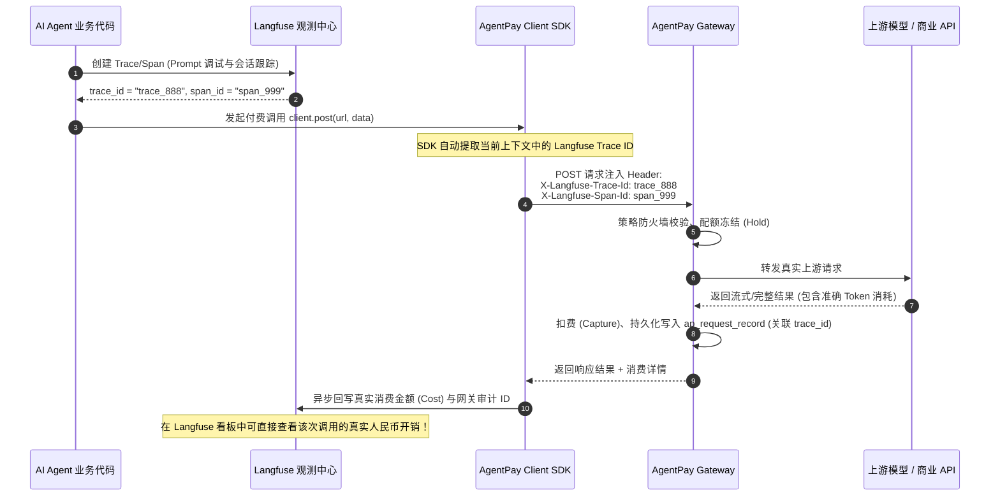

# 与 Langfuse 深度共生：打造企业级 AI 运维双子星

> **版本**：v1.0.0  
> **适用范围**：AgentFinOps 控制台、Langfuse 开源平台、Python/TypeScript Client SDK  
> **关联规划**：Master Roadmap v2.0.0 模块四（4.2 与 Langfuse 深度共生）

---

## 1. 为什么与 Langfuse 联合？

在大模型与 Agent 工程化落地过程中，企业需要解决两类不同维度的诉求：

```text
┌────────────────────────────────────────────────────────────────────────┐
│                        AI 智能体全生命周期运维双子星                   │
├───────────────────────────────────┬────────────────────────────────────┤
│         Langfuse (开源 MIT)       │         AgentPay (开源核心网关)    │
│            【管好大脑】           │             【管住双手】           │
├───────────────────────────────────┼────────────────────────────────────┤
│ • Prompt 模板管理与版本回溯       │ • 拦截外部真实金钱交易与工具调用   │
│ • Token 级推理链路追踪 (Tracing)  │ • 物理切断 AI 陷入死循环时的网络请求│
│ • 模型回答质量评估与评分 (Eval)   │ • 部门树状多层配额预算封顶与熔断   │
│ • 异常输出定位与 Badcase 收集     │ • 飞书/企微/钉钉大额审批流 (HITL)  │
│                                   │ • 人民币 6 位微单位只追加不可变账本│
└───────────────────────────────────┴────────────────────────────────────┘
```

**我们坚决不重复造轮子**：AgentPay 不开发多余的 Prompt 调试器或 LLM 打分器，而是与顶流开源观测平台 **Langfuse** 深度打通，共同构成企业级生产环境的闭环基建。

---

## 2. 全链路数据透传时序



---

## 3. 极速接入代码 (Python & TypeScript)

### 3.1 Python 零侵入自动装配

在已有 Langfuse 的 Python 项目中，只需使用 `agentpay_core.observability.langfuse` 自动挂载：

```python
from langfuse import Langfuse
from langfuse.openai import openai  # 或原生 openai 客户端
from agentpay_core import AgentPayClient
from agentpay_core.observability.langfuse import link_langfuse_context

# 1. 初始化 Langfuse
langfuse = Langfuse()

# 2. 初始化 AgentPay
agentpay_client = AgentPayClient(
    api_key="apk_live_xxx",
    gateway_url="https://gate.aipmedia.cn"
)

# 3. 一键联动上下文
# 后续所有通过 agentpay 发起的调用，自动继承当前线程/协程的 trace_id
link_langfuse_context(agentpay_client, langfuse)
```

### 3.2 TypeScript / Node.js 接入

```typescript
import { Langfuse } from "langfuse";
import { AgentPayClient } from "agentpay-core-sdk";

const langfuse = new Langfuse();
const agentPay = new AgentPayClient({
  apiKey: process.env.AGENT_API_KEY!,
  gatewayUrl: "https://gate.aipmedia.cn",
});

// 在当前 Span 中发起带 trace 追踪的请求
const trace = langfuse.trace({ name: "financial_qa_agent" });
const span = trace.span({ name: "fetch_stock_quote" });

const response = await agentPay.get("https://gate.aipmedia.cn/api/v1/stock/quote", {
  params: { symbol: "600519" },
  headers: {
    "X-Langfuse-Trace-Id": trace.id,
    "X-Langfuse-Span-Id": span.id,
  },
});

span.end({
  output: response.data,
  metadata: {
    agentpay_intent_id: response.headers["x-agentpay-intent-id"],
    cost_base_units: response.headers["x-agentpay-amount-base-units"],
  },
});
```

---

## 4. 控制台联动与联合排查面板

在 AgentFinOps 企业控制台的 **审计日志与行为时间线** 中：
- 每一笔带有 `trace_id` 的调用记录，均会展示 **Langfuse 快捷徽标**；
- 点击即可在新标签页直达 Langfuse 对应 Trace 详情页，完整回溯 Prompt 输入、上下文检索、Token 消耗以及 LLM 输出。

实现了 **“输入 Prompt $\to$ 意图决策 $\to$ 资金拦截 $\to$ 真实扣费 $\to$ 结果呈现”** 的端到端闭环追溯！
