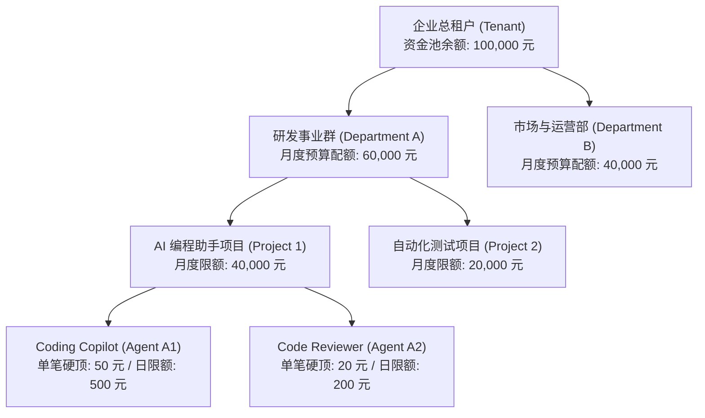

# 树状组织多层配额模型与预算控制体系 (FinOps Quota Governance)

> **版本**：v2.0.0  
> **适用范围**：AgentFinOps 企业控制台、Go Gateway 策略执行引擎、PostgreSQL 存储域  
> **关联规划**：Master Roadmap v2.0.0 模块二（2.1 树状组织多层配额体系）

---

## 1. 业务痛点与架构愿景

企业在规模化接入大模型与智能体时，面临极其突出的财务治理痛点：
1. **费用一锅粥**：所有项目与 Agent 共享同一个 API Key 或总账户，月末数十万开销无法核算到具体事业群或部门；
2. **死循环穿透风险**：某一个边缘实验项目的 Agent 陷入死循环递归调用，导致整个企业总账户额度被瞬间刷爆，核心生产业务被迫瘫痪；
3. **缺乏级联审批与动态划拨**：无法按季度或按月向下级业务线安全授权配额。

AgentPay 提出**四级成本切分与树状预算治理架构**：
$$\text{企业租户 (Tenant)} \longrightarrow \text{事业群/部门 (Department)} \longrightarrow \text{项目组 (Project)} \longrightarrow \text{具体智能体 (Agent)}$$

---

## 2. 级联预算约束公式与不变式 (Cascade Invariant)

在 AgentPay 核心网关中，任何一笔外部请求的发起，必须在 $O(1)$ 时间内严格满足以下**四层级联不变式（Cascade Invariant）**：

$$\begin{cases}
\text{Agent.spent}_{24h} + \Delta \le \text{Agent.daily\_budget\_cap} & \text{(Agent 层级限制)} \\
\text{Project.spent}_{month} + \Delta \le \text{Project.monthly\_budget\_cap} & \text{(项目组层级限制)} \\
\text{Department.spent}_{month} + \Delta \le \text{Department.monthly\_budget\_cap} & \text{(部门层级限制)} \\
\text{Tenant.available\_balance} \ge \Delta & \text{(租户总钱包余额)}
\end{cases}$$

- **$\Delta$（本次调用预估最大金额）**：由路由标价或 Token 上限计算得出；
- **若任何一层超限**：网关毫秒级阻断，准确定位报错（如 `QUOTA_EXCEEDED_DEPARTMENT`），阻断信号立即通知负责人，同时同租户下其他部门与项目的调用完全不受影响。

---

## 3. 预算模型生命周期

### 3.1 事前预算评估与冻结 (Pre-flight Hold)
当 Agent 发起 HTTP 请求时：
1. 网关读取目标路由的单价或预估 Token 上限；
2. 校验四级配额是否充足；
3. 原子锁定配额：在虚拟钱包中执行 `Hold` 动作，扣减 `available_cache`，增加 `held_cache`。

### 3.2 毫秒级流式计量 (Real-time Token Metering)
1. 网关反向代理至上游模型服务，流式解析 LLM 的 SSE 数据帧；
2. 捕获最终的 `usage.prompt_tokens` 与 `usage.completion_tokens`；
3. 计算本次实际应收金额 $\text{ActualCost}$。

### 3.3 事后确认扣除与释放 (Capture & Release)
1. **确认扣费 (Capture)**：将实际消耗金额 $\text{ActualCost}$ 转化为不可变记账凭证（`ap_ledger_entry`）；
2. **释放剩余 (Release)**：将多预留的额度 $(\Delta - \text{ActualCost})$ 即刻返还至可用额度；
3. **若调用失败/超时**：将全部预留额度 $\Delta$ 原子释放（`Release`），绝不产生悬挂扣款。

---

## 4. 部门熔断机制与异动告警 (Circuit Breaker)

为防御智能体因为逻辑死循环（Runaway Agent Loop）导致成本失控，系统设置了两道防线：

1. **瞬时 RPM 熔断器 (Sliding Window RPM Guard)**：
   - 当单 Agent 或单项目的每分钟调用频次超过设定上限（如 60 RPM）时，策略引擎立即将熔断器状态由 `CLOSED` 切换为 `OPEN`；
   - 所有后续请求在本地内存阶段直接拦截，返回 `429 RATE_LIMIT_EXCEEDED`。

2. **自适应异动检测 (Anomaly Detection)**：
   - 持续监控单 Agent 调用频次与金额偏离度；
   - 首次异常触发企业微信/飞书/钉钉告警通知管理员；
   - 持续异常自动降级 API Key 权限或移入隔离观察区。
