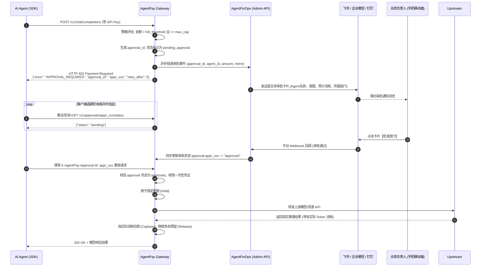
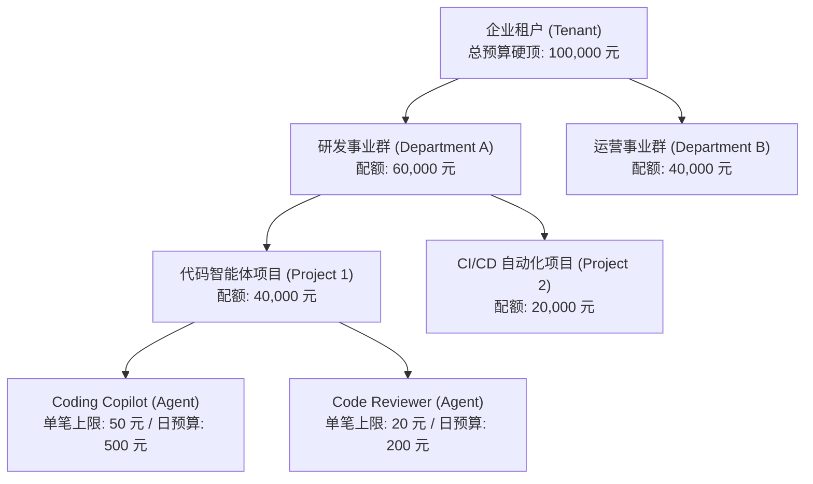
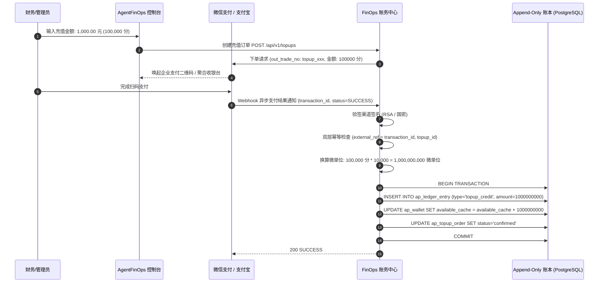

# AgentPay 核心任务全景规划实施路线与落地执行计划 (Master Execution Plan)

> **版本**：v2.0.0-EXECUTION**状态**：**官方主线研发实施纲领 (Approved Implementation Spec)\*\***核心定位**：**企业级 AI 行为审计与资金防火墙网关 (AI Agent Gateway & FinOps)\***\*基线规划**：对齐《AgentPay 核心任务全景规划与技术演进路线图 (Master Roadmap) v2.0.0》**代码仓库分工**：
>
> - `AgentFinOps`：企业管理平面、控制台 Web、FinOps 财务与配额中心、审批回调接收器、发票核销。
> - `agent-core-sdk`：核心网关运行时引擎（Go）、多语言客户端 SDK（Python / TypeScript / Java）、MCP 支付插件、卖方中间件。

---

## 1. 架构总览与双仓职责边界 (Architecture & Repo Boundary)

在完成代码库彻底分离后，系统呈现出高度解耦的双轨协同架构：

```text
┌────────────────────────────────────────────────────────────────────────────────────────┐
│                                 AgentFinOps 控制与运营平面                              │
│                                                                                        │
│   ┌──────────────────────────┐   ┌──────────────────────────┐   ┌──────────────────┐   │
│   │   apps/console (Vue 3)   │   │ apps/marketplace-web     │   │ infra / DB       │   │
│   │ • 树状组织/部门/配额治理  │   │ • API 开放市场           │   │ • PostgreSQL 15+ │   │
│   │ • 飞书/企微 HITL 审批配置│   │ • 开发者一键体验         │   │ • Redis 7+       │   │
│   │ • 法币充值/发票核销/流水 │   │ • 服务商入驻与发布       │   │ • 日终对账调度器 │   │
│   │ • Langfuse 联动追踪面板  │   └──────────────────────────┘   └──────────────────┘   │
│   └─────────────┬────────────┘                                                         │
└─────────────────┼──────────────────────────────────────────────────────────────────────┘
                  │ 组织配额同步 / 充值入账 / 审批解挂回调
                  ▼
┌────────────────────────────────────────────────────────────────────────────────────────┐
│                              agent-core-sdk 核心网关与 SDK 矩阵                        │
│                                                                                        │
│   ┌────────────────────────────────────────────────────────────────────────────────┐   │
│   │ gateway/ (Go 核心网关运行时)                                                   │   │
│   │ • 树状配额层级级联预检 (Tenant -> Department -> Project -> Agent)               │   │
│   │ • HTTP 402 异步挂起引擎 (approval_id 生成 + 协作通知投递 + 轮询/重放解挂)       │   │
│   │ • 双层幂等虚拟账本 (Hold -> Capture -> Release 三态防悬挂)                     │   │
│   │ • 毫秒级 Token 流式微计费与高频批量记账缓冲                                    │   │
│   │ • Langfuse trace_id / span_id 提取与全链路审计日志注入                         │   │
│   └────────────────────────────────────────────────────────────────────────────────┘   │
│                                                                                        │
│   ┌──────────────────────────┐   ┌──────────────────────────┐   ┌──────────────────┐   │
│   │ python/ & typescript/    │   │ java/ (Spring Boot)      │   │ mcp/ (MCP 插件)  │   │
│   │ • 402 自动重放与挂起等待 │   │ • @AgentPayGuard 注解    │   │ • Server 计费插件│   │
│   │ • 进程内策略防护引擎     │   │ • 政企业务网关 Starter   │   │ • Client 额度拦截│   │
│   │ • Langfuse 自动装配器    │   │                          │   │                  │   │
│   └──────────────────────────┘   └──────────────────────────┘   └──────────────────┘   │
└────────────────────────────────────────────────────────────────────────────────────────┘
```

---

## 2. 核心架构时序与协议规范 (Core Sequence Flows)

### 2.1 办公协同与人在回路（HITL）审批时序

三级风控判定：

1. **小额** ($\le$ `hitl_threshold`)：毫秒级放行；
2. **中大额** (`hitl_threshold` < 金额 $\le$ `max_tx_cap`)：触发 402 异步挂起 + 飞书/企微/钉钉卡片推送；
3. **超大额** (> `max_tx_cap`)：直接拒绝返回 `SINGLE_TX_CAP_EXCEEDED`。



---

### 2.2 树状多层配额模型 (Tenant -> Department -> Project -> Agent)



**级联校验逻辑 (Cascade Quota Invariant)**：
任何一笔扣款必须满足：

$$
\begin{cases}
\text{Agent.spent}_{24h} + \Delta \le \text{Agent.daily\_cap} \\
\text{Project.spent}_{month} + \Delta \le \text{Project.monthly\_budget} \\
\text{Department.spent}_{month} + \Delta \le \text{Department.monthly\_budget} \\
\text{Tenant.available\_balance} \ge \Delta
\end{cases}
$$

任何一层超限立即阻断并上报指标。

---

### 2.3 国内合规法币充值与精度换算 (6 位微单位无浮点数存储)

外部充值渠道以人民币“分”（两位小数）交互，入账边界严格执行：

$$
\text{amount\_base\_units} = \text{payment\_minor\_amount} \times 10,000
$$

全程严禁浮点数运算。



---

### 2.4 MCP 原生标价与客户端防火墙

- **MCP Server 端（标价中间件）**：
  在 MCP Tool Definition 的 `metadata` 中注入 `agentpay` 标价：
  ```json
  {
    "name": "generate_financial_report",
    "description": "生成季度财务报表",
    "inputSchema": { ... },
    "metadata": {
      "agentpay": {
        "price_base_units": 5000000,
        "asset": "CNY",
        "settlement_type": "prepaid_hold"
      }
    }
  }
  ```
- **MCP Client 端（金融防火墙中间件）**：
  拦截 LLM 发出的 `tools/call` 请求：
  1. 读取目标 Tool 的 `metadata.agentpay`；
  2. 触发本地 PolicyEngine 预检：是否超单笔、超日预算、是否需要 HITL；
  3. 执行网关 Hold 冻结；
  4. 真正执行 Tool Call；
  5. 成功后 Capture 确认，异常或拒绝则 Release。

---

### 2.5 Langfuse 深度共生全链路观测

- **定位分工**：
  - **Langfuse**：Prompt 追踪、Token 计量、LLM 评分（大脑监控）。
  - **AgentPay**：金钱拦截、配额扣减、不可篡改对账（双手防火墙）。
- **联合打通**：
  在 Client SDK 与 Gateway 中间件中：
  - SDK 自动从 Langfuse 上下文提取当前 `langfuse_trace_id` 与 `langfuse_observation_id` (Span ID)；
  - 请求网关时自动注入 HTTP 请求头：
    - `X-Langfuse-Trace-Id: <trace_id>`
    - `X-Langfuse-Span-Id: <span_id>`
  - 网关在 `ap_request_record` 与 `ap_agent_audit_event` 中严格持久化该 Trace 关联；
  - 控制台提供一键跳转 Langfuse Trace 页面与联合排查面板。

---

## 3. 落地实施阶段路线图 (Phase-by-Phase Roadmap)

```text
┌────────────────────────────────────────────────────────────────────────┐
│ Phase 1: P0 近期主线 (Enterprise HITL + Multi-Tier FinOps + MCP & Langfuse) │
├────────────────────────────────────────────────────────────────────────┤
│ • Epic 1.1: 树状部门组织与级联配额引擎 (DDL, Gateway Check, Console UI)   │
│ • Epic 1.2: HITL 人在回路审批与 402 异步挂起 (Approval, Feishu/WeCom Bot) │
│ • Epic 1.3: 国内合规法币预付充值与双层幂等入账 (WeChat/Alipay Webhook)   │
│ • Epic 1.4: MCP 协议原生支付中间件与客户端防火墙 (Server & Client)       │
│ • Epic 1.5: Langfuse 深度共生全链路 Trace 观测面板                      │
└───────────────────────────────────┬────────────────────────────────────┘
                                    ▼
┌────────────────────────────────────────────────────────────────────────┐
│ Phase 2: P1 重要演进 (Streaming Metering + Java/Spring Boot & Node.js)   │
├────────────────────────────────────────────────────────────────────────┤
│ • Epic 2.1: 毫秒级 Token 流式微计费与高频批量记账缓冲落盘              │
│ • Epic 2.2: Java / Spring Boot Starter SDK (@AgentPayGuard)            │
│ • Epic 2.3: Node.js / Express / Fastify / NestJS 卖方中间件            │
└───────────────────────────────────┬────────────────────────────────────┘
                                    ▼
┌────────────────────────────────────────────────────────────────────────┐
│ Phase 3: P2 架构深化 (KMS/国密 HSM + 独立 Sidecar + 分布式集群与对账)   │
├────────────────────────────────────────────────────────────────────────┤
│ • Epic 3.1: 进程外隔离 Sidecar 守护进程 (UDS / IPC 防御 N6 任意代码风险)│
│ • Epic 3.2: 云端 KMS (阿里云/腾讯云/AWS) 与国密 HSM 硬件安全签名 (N1)  │
│ • Epic 3.3: 分布式网关集群 (Raft/Redis 事件总线) 与五重对账调度器      │
└───────────────────────────────────┬────────────────────────────────────┘
                                    ▼
┌────────────────────────────────────────────────────────────────────────┐
│ Phase 4: P3 生态远景 (私有化套件与行业标准化)                           │
├────────────────────────────────────────────────────────────────────────┤
│ • Epic 4.1: 企业专有私有化套件 (Docker Compose / Helm Chart 一键交付)   │
│ • Epic 4.2: 推动企业级 AI 行为审计与资金防火墙行业规范标准草案          │
└────────────────────────────────────────────────────────────────────────┘
```

---

## 4. Phase 1 (P0 近期主线) 详细任务分解与执行清单

### Epic 1.1: 树状部门组织与级联配额引擎

- [ ] **Task 1.1.1 (AgentFinOps DDL & 实体演进)**
  - **文件**：`AgentFinOps/infra/postgres/schema.sql`
  - 新增 `ap_department` 表：
    ```sql
    CREATE TABLE IF NOT EXISTS ap_department (
        department_id VARCHAR(64) PRIMARY KEY,
        tenant_id VARCHAR(64) NOT NULL REFERENCES ap_tenant(tenant_id) ON DELETE CASCADE,
        parent_id VARCHAR(64) NULL REFERENCES ap_department(department_id) ON DELETE CASCADE,
        name VARCHAR(128) NOT NULL,
        budget_cap_monthly_base_units BIGINT NOT NULL DEFAULT 0,
        status VARCHAR(32) NOT NULL DEFAULT 'active' CHECK (status IN ('active', 'archived')),
        created_at TIMESTAMPTZ NOT NULL DEFAULT CURRENT_TIMESTAMP,
        updated_at TIMESTAMPTZ NOT NULL DEFAULT CURRENT_TIMESTAMP
    );
    ```
  - `ap_project` 表增加 `department_id VARCHAR(64) NULL REFERENCES ap_department(department_id)`。
  - 在 `ap_usage_event`、`ap_payment_intent` 中增加 `department_id` 冗余列，方便日终财务按部门聚合核销。

- [ ] **Task 1.1.2 (agent-core-sdk 级联配额校验引擎)**
  - **文件**：`agent-core-sdk/gateway/admin/`、`agent-core-sdk/gateway/statemachine/`
  - 实现四层配额层级链式校验：租户总可用额度 $\to$ 部门月度配额 $\to$ 项目组月度配额 $\to$ Agent 单笔/日限额。
  - 编写并发安全单元测试，确保配额不足时准确定位返回 `QUOTA_EXCEEDED_DEPARTMENT` 或 `QUOTA_EXCEEDED_PROJECT`。

- [ ] **Task 1.1.3 (AgentFinOps 控制台部门与配额管理 UI)**
  - **文件**：`AgentFinOps/apps/console/src/views/departments/`、`AgentFinOps/apps/console/src/router/`
  - 新增部门树状列表（支持无限级树形结构展示、预算划拨与实时消耗进度条）。

---

### Epic 1.2: HITL 人在回路审批与 402 异步挂起

- [ ] **Task 1.2.1 (agent-core-sdk 402 异步挂起机制)**
  - **文件**：`agent-core-sdk/gateway/x402/handler.go`、`agent-core-sdk/gateway/x402/approval.go`
  - 在中间件中检测如果请求金额落在 `[hitl_threshold, max_tx_cap]` 区间，或者命中特定敏感 Tool：
    - 生成持久化 `approval_id`；
    - 返回 `402 Payment Required`，响应头携带 `X-AgentPay-Approval-Id`，响应体包含审批凭证与预估耗时；
    - 状态入库为 `pending_approval`。

- [ ] **Task 1.2.2 (AgentFinOps 协同卡片推送与回调 Bot)**
  - **文件**：`AgentFinOps/services/gateway/internal/hitl/feishu.go`、`wecom.go`、`dingtalk.go`
  - 接入飞书互动卡片（CardKit）与企业微信审批卡片。
  - 提供安全回调接口 `/api/v1/webhooks/approvals/{channel}` 处理移动端负责人点击【批准】/【拒绝】。
  - 校验回调签名，审批通过后将网关审批单置为 `approved`。

- [ ] **Task 1.2.3 (agent-core-sdk Python/TypeScript SDK 自动解挂重放)**
  - **文件**：`agent-core-sdk/python/agentpay_core/client.py`、`agent-core-sdk/typescript/src/client.ts`
  - SDK 收到带有 `approval_id` 的 402 响应时，进入优雅挂起等待状态：
    - 输出控制台日志提醒开发者或终端：“Waiting for human approval (approval_id: appr_xxx)...”；
    - 默认按退避间隔轮询网关状态，或等待 Webhook 解挂；
    - 一旦获得 `approved`，自动携带 `X-AgentPay-Approval-Id` 重新发起调用并返回结果，对上层业务代码完全透明。

---

### Epic 1.3: 国内合规法币预付充值与双层幂等入账

- [ ] **Task 1.3.1 (充值 DDL 与双层唯一索引强化)**
  - **文件**：`AgentFinOps/infra/postgres/schema.sql`
  - 在 `ap_topup_order` 建立组合唯一索引：
    ```sql
    CREATE UNIQUE INDEX IF NOT EXISTS uq_topup_external_ref ON ap_topup_order(channel, external_ref)
        WHERE external_ref IS NOT NULL;
    ```

- [ ] **Task 1.3.2 (微信/支付宝企业充值处理服务)**
  - **文件**：`AgentFinOps/services/gateway/internal/billing/topup.go`
  - 严格执行微单位无浮点转换：`amount_base_units = payment_minor_amount * 10000`。
  - 实现双层幂等防重放，数据库行级锁保证账本原子写入（`ap_ledger_entry` + `ap_wallet` 缓存）。

- [ ] **Task 1.3.3 (控制台在线充值收银台与数电发票申请)**
  - **文件**：`AgentFinOps/apps/console/src/views/billing/`
  - 微信/支付宝动态 Native 二维码生成；对公转账流水凭证上传与财务审核流。

---

### Epic 1.4: MCP 协议原生支付中间件

- [ ] **Task 1.4.1 (MCP Server 标价插件)**
  - **文件**：`agent-core-sdk/typescript/src/mcp/server.ts`、`agent-core-sdk/python/agentpay_core/mcp/server.py`
  - 包装 MCP Server 的 `ListTools` 与 `CallTool`，自动将价格元数据注入 Tools 描述中。

- [ ] **Task 1.4.2 (MCP Client 资金防火墙插件)**
  - **文件**：`agent-core-sdk/typescript/src/mcp/client.ts`、`agent-core-sdk/python/agentpay_core/mcp/client.py`
  - 拦截 Client 的 `callTool`，提取预估金额，通过本地策略引擎判定放行、挂起或阻断，原子执行 Hold/Capture。

---

### Epic 1.5: 与 Langfuse 深度共生全链路观测

- [ ] **Task 1.5.1 (SDK 与 Gateway Trace 注入与传递)**
  - **文件**：`agent-core-sdk/python/agentpay_core/observability/langfuse.py`、`agent-core-sdk/gateway/x402/handler.go`
  - 自动读取 Langfuse Trace 上下文，注入 HTTP Header `X-Langfuse-Trace-Id`。
  - 网关持久化保存到 `ap_request_record.trace_id` 与 `ap_agent_audit_event.data`。

- [ ] **Task 1.5.2 (AgentFinOps 控制台联合排查面板)**
  - **文件**：`AgentFinOps/apps/console/src/views/timeline/`
  - 审计流水明细中展示 Langfuse 徽标，点击直跳对应 Langfuse 项目的 Trace 详情页。

---

## 5. 验收标准与交付产物清单 (Definition of Done)

| 模块              | 关键验收指标                                                                                                                                   | 交付代码与测试产物                                                               |
| :---------------- | :--------------------------------------------------------------------------------------------------------------------------------------------- | :------------------------------------------------------------------------------- |
| **HITL 审批**     | 1. 超过阈值请求自动挂起并返回 402，且包含有效`approval_id`。<br/>2. 飞书/企微卡片 1 秒内收到推送。<br/>3. 点击放行后客户端自动恢复并成功调用。 | 单元与集成测试：`test_hitl_lifecycle`，覆盖挂起、拒绝、超时、通过 4 种状态分支。 |
| **树状配额**      | 1. 部门超限时精准阻断，不影响同租户其他部门。<br/>2. 满足父子配额级联一致性。                                                                  | 并发测试：`TestDepartmentCascadeBudget`（100 并发压测不发生配额击穿）。          |
| **法币充值**      | 1. 金额换算严格乘 10000 转换为 6 位微单位整数，严禁浮点运算。<br/>2. 重复 Webhook 触发严格幂等跳过，无二次充值。                               | 测试套件：`TestTopUpIdempotencyAndPrecision`。                                   |
| **MCP 支付**      | 1. MCP Client 本地拦截率 100%。<br/>2. 超额 Tool Call 毫秒级直接在端侧拦截，不产生网络浪费。                                                   | MCP 样例工具套件：`examples/mcp-paid-tools`。                                    |
| **Langfuse 联动** | 1. 网关审计流水与 Langfuse 平台 Trace 100% 对应。<br/>2. 控制台一键直达对应 Langfuse Span。                                                    | 联合演示端到端链路测试：`test_langfuse_agentpay_e2e`。                           |
