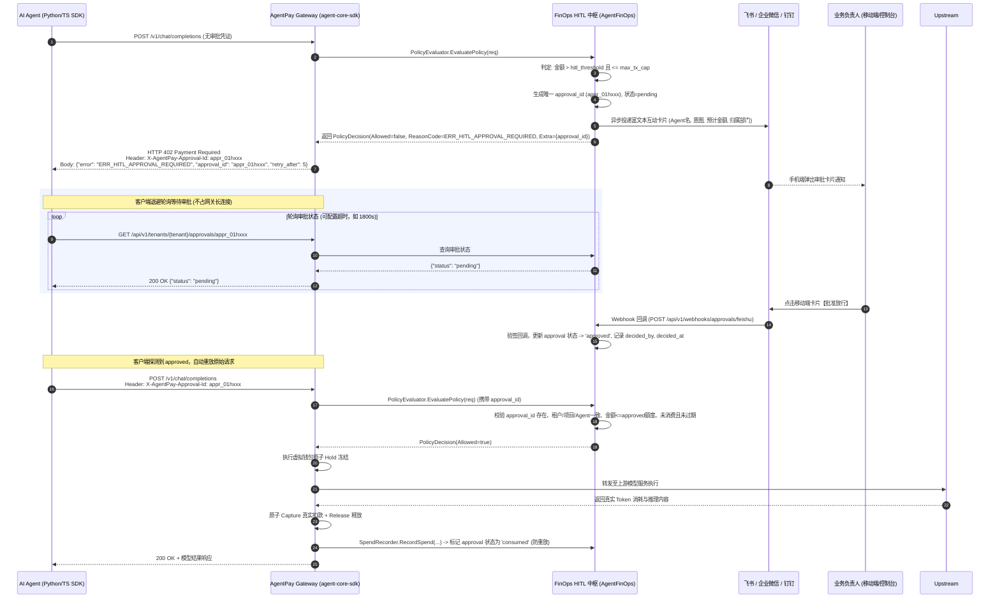

# Epic 1.2: 办公协同与人在回路 (HITL) 审批与 402 异步挂起引擎详细设计与实施计划

> **规范版本**：v2.0.0-HITL  
> **状态**：**待确认设计方案 (Awaiting User Review)**  
> **核心定位**：**架设在“AI 智能与推理”与“外部资金与数据资源”之间的企业级金融防火墙（Financial Firewall）与人在回路中枢**  
> **对齐规划**：《AgentPay 核心任务全景规划与技术演进路线图 (Master Roadmap) v2.0.0》 Epic 1.2

---

## 1. 业务愿景与核心痛点

在生产环境中，自主 AI Agent 具备连续自主调用外部昂贵工具（如量化买卖、大模型重度推理、外部数据采购、付费 API 调用）的能力。若缺乏有效的人在回路（Human-in-the-Loop, HITL）防火墙，企业将面临：
1. **死循环与预算失控风险**：Agent 陷入 Prompt 死循环或逻辑缺陷，连续高频触发大额收费 API，瞬间刷爆部门乃至企业总预算；
2. **缺乏事中审批兜底**：传统网关要么“全放行（事后看账单痛哭）”，要么“全拦截（阻断正常高价值业务）”，缺乏精细化的三级风险梯度；
3. **HTTP 长连接挂起崩溃**：人工审批通常需要数秒至数十分钟，若采用传统 HTTP 长连接等待，将迅速耗尽网关连接池与文件描述符（FD）；
4. **凭证重放与安全悬挂**：审批放行后的凭证如果可无限次重用，将形成恶意的重放攻击（Replay Attack）。

AgentPay 通过 **三级风控判定 + HTTP 402 状态码异步挂起 + 飞书/企微/钉钉移动端一键放行 + 单次防重放核销**，彻底解决上述痛点。

---

## 2. 三级风控判定与时序闭环

### 2.1 三级风控判定状态机

```text
                                  发起支付/调用请求
                                         │
                                         ▼
                            ┌────────────────────────┐
                            │   核验单笔金额与策略   │
                            └────────────┬───────────┘
                                         │
         ┌───────────────────────────────┼───────────────────────────────┐
         ▼                               ▼                               ▼
  【1. 小额极速通道】             【2. 中大额审批通道】             【3. 超大额熔断通道】
金额 ≤ hitl_threshold          hitl_threshold < 金额 ≤ max_tx_cap        金额 > max_tx_cap
         │                               │                               │
         │                               │                               ▼
         │                               │                      直接硬顶阻断 (403/400)
         │                               │                      SINGLE_TX_CAP_EXCEEDED
         │                               │
         │                  ┌────────────┴────────────┐
         │                  │ 是否携带已审批有效凭证? │
         │                  └────────────┬────────────┘
         │                               │
         │                 有 (已批准且未消费)  无 / 待审批 / 已过期
         │                               │        │
         │                               │        ▼
         │                               │   生成 approval_id (入库 pending)
         │                               │   推送飞书/企微/钉钉审批卡片
         │                               │   返回 HTTP 402 Payment Required
         │                               │   {"error":"ERR_HITL_APPROVAL_REQUIRED",
         │                               │    "approval_id":"appr_xxx"}
         │                               │
         ▼                               ▼
  原子执行 Hold 预冻结 ────────── 核销审批凭证 (consumed)
         │
         ▼
  转发上游 API 执行推理
         │
         ▼
  Capture 实际结算扣款 + 释放多余预留
```

---

### 2.2 402 异步挂起与解挂完整时序图



---

## 3. 架构分工与工程目录结构

根据经过批准的方案 A（通用核心 SDK 与企业中控分离原则）：
- `agent-core-sdk` 保持绝对通用，不出现任何第三方 OA 平台（飞书/企微/钉钉）或特定企业数据表结构；
- 所有审批单持久化、OA 卡片拼装、审批回调验签及 Console UI 集中在 `AgentFinOps`。

```text
AgentFinOps/
├── infra/
│   └── postgres/
│       └── schema.sql                          # 已就绪: ap_approval_request 表与索引
├── services/
│   └── gateway/
│       ├── cmd/
│       │   └── gateway/
│       │       └── main.go                     # 装配 HITL Evaluator, Recorder 与审批路由
│       └── internal/
│           └── enterprise/
│               └── hitl/                       # 【新增】HITL 审批领域子系统
│                   ├── models.go               # ApprovalRequest 实体、状态、DTO
│                   ├── service.go              # 审批 CRUD、状态机扭转与防重放消费
│                   ├── enforcer.go             # 实现 agent.PolicyEvaluator (三级风控预检)
│                   ├── recorder.go             # 实现 agent.SpendRecorder (消费核销)
│                   ├── handler.go              # REST 接口: 审批列表/详情/人工批准/驳回
│                   ├── webhook_handler.go      # OA 平台 Webhook 回调接口与验签
│                   ├── hitl_test.go            # 单元测试: 三级风控、审批放行与防重放
│                   └── channels/               # OA 协同卡片驱动
│                       ├── channel.go          # Sender 统一接口
│                       ├── feishu.go           # 飞书 CardKit 富文本卡片构建与 Webhook 推送
│                       ├── wecom.go            # 企业微信审批卡片构建与推送
│                       └── dingtalk.go         # 钉钉互动卡片构建与推送
└── apps/
    └── console/                                # 前端控制台
        ├── src/
        │   ├── api/
        │   │   └── client.ts                   # 审批 API 客户端 (getApprovals, decide)
        │   ├── types/
        │   │   └── tenant.ts                   # ApprovalRequest 前端类型
        │   ├── router/
        │   │   └── index.ts                    # 注册 /approvals 路由
        │   └── views/
        │       └── approvals/
        │           └── index.vue               # 【新增】审批流转中枢页面 (待办/历史/一键批准)

agent-core-sdk/ (通用适配)
├── gateway/
│   ├── x402/
│   │   └── handler.go                          # 从 HTTP Header 提取 X-AgentPay-Approval-Id 透传至 PolicyRequest
│   └── agent/
│       └── evaluator.go                        # PolicyRequest 结构支持 ApprovalID 字段
├── python/
│   └── agentpay_core/
│       └── client.py                           # 遇到 402 ERR_HITL_APPROVAL_REQUIRED 自动退避等待与自愈重放
└── typescript/
    └── src/
        └── client.ts                           # TS 客户端 402 自动重试自愈
```

---

## 4. 详细接口设计与数据模型

### 4.1 核心数据结构 (`services/gateway/internal/enterprise/hitl/models.go`)

```go
type ApprovalStatus string

const (
	ApprovalStatusPending  ApprovalStatus = "pending"  // 待审批
	ApprovalStatusApproved ApprovalStatus = "approved" // 已批准放行，等待客户端重放
	ApprovalStatusRejected ApprovalStatus = "rejected" // 已驳回
	ApprovalStatusExpired  ApprovalStatus = "expired"  // 超时未审批已失效
	ApprovalStatusConsumed ApprovalStatus = "consumed" // 已被网关核销扣款 (防止重复消费)
)

type ApprovalRequest struct {
	ApprovalID      string         `json:"approval_id"`
	TenantID        string         `json:"tenant_id"`
	DepartmentID    string         `json:"department_id,omitempty"`
	ProjectID       string         `json:"project_id"`
	AgentID         string         `json:"agent_id"`
	IntentID        string         `json:"intent_id,omitempty"`
	AmountBaseUnits int64          `json:"amount_base_units"`
	Asset           string         `json:"asset"`
	Status          ApprovalStatus `json:"status"`
	TriggerReason   string         `json:"trigger_reason"` // "threshold_exceeded", "sensitive_tool"
	Channel         string         `json:"channel,omitempty"` // "feishu", "wecom", "dingtalk", "console"
	CardMsgID       string         `json:"card_msg_id,omitempty"`
	DecidedBy       string         `json:"decided_by,omitempty"`
	DecidedAt       *time.Time     `json:"decided_at,omitempty"`
	RejectionReason string         `json:"rejection_reason,omitempty"`
	Nonce           string         `json:"nonce"`
	ExpiresAt       time.Time      `json:"expires_at"`
	CreatedAt       time.Time      `json:"created_at"`
	UpdatedAt       time.Time      `json:"updated_at"`

	// 辅助展示元数据 (Prompt/ToolName/AgentName 等)
	Metadata map[string]interface{} `json:"metadata,omitempty"`
}

type HITLPolicy struct {
	Enabled                bool  `json:"enabled"`
	ThresholdBaseUnits     int64 `json:"threshold_base_units"`      // 超过此值触发审批 (如 10.00 元 = 10_000_000 微单位)
	SingleTxCapBaseUnits   int64 `json:"single_tx_cap_base_units"`   // 单笔硬顶，超过直接报错 (如 500.00 元)
	ApprovalTimeoutSeconds int   `json:"approval_timeout_seconds"`  // 审批有效期 (默认 1800 秒 / 30分钟)
}
```

### 4.2 审批服务接口 (`service.go`)

```go
type Service interface {
	// 策略与创建
	GetPolicy(ctx context.Context, tenantID, projectID, agentID string) (*HITLPolicy, error)
	CreateApproval(ctx context.Context, req *CreateApprovalInput) (*ApprovalRequest, error)
	
	// 检索与状态查询
	GetApproval(ctx context.Context, tenantID, approvalID string) (*ApprovalRequest, error)
	ListApprovals(ctx context.Context, tenantID string, status ApprovalStatus, limit, offset int) ([]*ApprovalRequest, int64, error)
	
	// 人工决策 (支持 Console 与 Webhook 回调)
	Approve(ctx context.Context, tenantID, approvalID, decidedBy string) (*ApprovalRequest, error)
	Reject(ctx context.Context, tenantID, approvalID, decidedBy, reason string) (*ApprovalRequest, error)
	
	// 消费核销 (网关在 Capture 成功后调用，原子置为 consumed，防重放)
	ConsumeApproval(ctx context.Context, tenantID, approvalID, projectID, agentID string, amount int64) error
}
```

### 4.3 REST API 协议规范

| 方法 | 路径 | 权限 | 说明 |
| :--- | :--- | :--- | :--- |
| `GET` | `/api/v1/tenants/{tenantID}/approvals` | Operator / Admin | 获取审批单分页列表 (支持 `status` 过滤) |
| `GET` | `/api/v1/tenants/{tenantID}/approvals/{approvalID}` | Viewer / SDK | 查询单笔审批单详情及当前状态 |
| `POST` | `/api/v1/tenants/{tenantID}/approvals/{approvalID}/approve` | Admin / Approver | 批准放行 |
| `POST` | `/api/v1/tenants/{tenantID}/approvals/{approvalID}/reject` | Admin / Approver | 驳回并填报原因 |
| `POST` | `/api/v1/webhooks/approvals/feishu` | 公网 Webhook (验签) | 飞书 CardKit 按钮交互事件回调 |
| `POST` | `/api/v1/webhooks/approvals/wecom` | 公网 Webhook (验签) | 企业微信审批/消息卡片事件回调 |
| `POST` | `/api/v1/webhooks/approvals/dingtalk` | 公网 Webhook (验签) | 钉钉互动卡片事件回调 |

---

## 5. 防重放与防悬挂安全设计 (Security Invariants)

1. **审批单严格绑定五元组**：
   一个审批单必须严格绑定 `(tenant_id, project_id, agent_id, route_id, amount_base_units)`。重放请求时，若请求的 Agent、Project 与审批单不一致，立即阻断。
2. **单次使用核销 (Single-Use Token Protection)**：
   审批单在状态为 `approved` 时仅可放行**一次**。在网关完成实际扣款时，`CascadeSpendRecorder` 将其状态原子更新为 `consumed`。若恶意客户端试图使用同一 `approval_id` 发起第二笔请求，将被拒绝返回 `ERR_APPROVAL_ALREADY_CONSUMED`。
3. **过期时效防悬挂 (TTL & Auto-Expire)**：
   审批单默认有效期为 30 分钟。超过 `expires_at` 未被批准的单据在轮询或重放时将自动置为 `expired`，不再允许批准或放行。
4. **Webhook 平台防伪造验签**：
   飞书、企微与钉钉的回调接口均严格校验各平台的时间戳、签名哈希（HMAC-SHA256）或 Token，防止黑客伪造审批通过请求。

---

## 6. 控制台页面规划 (`views/approvals/index.vue`)

控制台将新增 **【人在回路审批】(Approval Center)** 菜单与视图：
1. **统计概览卡片**：
   - 待处理审批 (Pending)
   - 今日已批准放行金额 (Approved Amount)
   - 今日拦截驳回笔数 (Rejected Count)
2. **多状态标签切换**：
   - `全部` / `待我审批` / `已批准` / `已驳回` / `已失效`
3. **交互操作与详情抽屉**：
   - 树形结构展示所属事业群/部门与项目；
   - 点击可查看触发该审批的 Agent 详情、调用路由、上报的 Task ID/Session ID；
   - 支持单笔或批量一键【批准放行】与【驳回】。

---

## 7. 分步实施执行清单 (Execution Milestones)

| 阶段 | 交付任务 | 涉及代码模块 | 验收标准 |
| :--- | :--- | :--- | :--- |
| **步骤 1** | 在 `agent-core-sdk` 中支持 `X-AgentPay-Approval-Id` 请求头透传与 402 Payload 规范化 | `agent-core-sdk/gateway` | 单元测试通过，未携带与携带审批头正确路由 |
| **步骤 2** | 在 `AgentFinOps` 中实现 `enterprise/hitl` 领域模型、存储层与状态流转机 | `AgentFinOps/services/gateway` | 状态机单测通过（pending $\to$ approved $\to$ consumed / rejected / expired） |
| **步骤 3** | 实现 HITL Evaluator & SpendRecorder，并与已有 CascadeQuota 串联装配到网关主入口 | `AgentFinOps/services/gateway` | 级联集成测试：小额放行、中额 402 挂起、审批后重放通过并核销 |
| **步骤 4** | 实现飞书/企微/钉钉卡片拼装器与 Webhook 审批回调网关 | `AgentFinOps/services/gateway` | 模拟 OA Webhook 验签通过并能成功触发审批单状态扭转 |
| **步骤 5** | 控制台 (`apps/console`) 审批中枢页面与 API 联动 | `AgentFinOps/apps/console` | 页面无缝加载待审批单、一键审批/驳回，Vite 编译 0 报错 |
| **步骤 6** | 客户端 SDK (`python` & `typescript`) 自愈重试功能升级 | `agent-core-sdk/python`, `typescript` | 客户端收到 402 后自动等待审批通过并成功重放 |

---

## 8. 决策审阅确认

请您审阅以上关于 **Epic 1.2 人在回路审批与 402 异步挂起引擎** 的详细设计方案：
- 架构分工（Core SDK 通用透传 + AgentFinOps 企业中枢）；
- 三级风控判定与时序闭环；
- 防重放安全核销机制；
- 控制台与 OA 平台协同方案。

若设计完全符合您的业务要求与技术预期，请确认批准，我们将立即严格按照上述分步计划开始代码实施！
