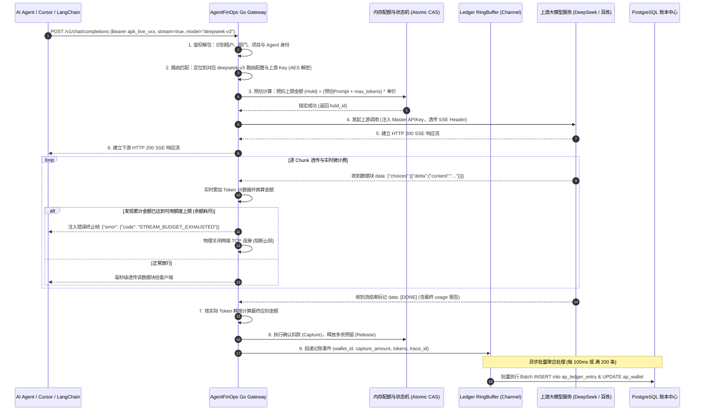

# 技术设计规范：基于路由层扩展的多厂商大模型网关与 SSE 流式微计费架构 (Scheme A)

> **版本**：v1.0.0 (生产级设计规范)  
> **制定日期**：2026-11-16  
> **设计状态**：**已定稿待实施 (Approved Specification - Scheme A)**  
> **适用范围**：Go 核心网关运行时 (`services/gateway` & `agent-core-sdk`)、管理控制台 (`apps/console`)、数据库存储 (`infra/postgres/schema.sql`)、主流 Agent 框架生态 (LangChain / CrewAI / Cursor / WorkBuddy)

---

## 1. 业务意图与核心背景 (Intent & Why)

在以自主智能体（AI Agent）为核心的企业生产应用中，95% 以上的模型推理调用都采用 **Server-Sent Events (SSE) 流式传输（`stream=true`）**。传统 API 网关面对大语言模型存在三大约束性死结：
1. **穿透欠费盲区**：若租户仅剩 ¥0.50 额度，但触发了一个耗时 2 分钟、生成 8,000 Token（价值 ¥3.00）的深思考推理任务，传统网关无法在中途感知 Token 累计，流结束扣费时形成严重坏账穿透。
2. **中途取消无法核销**：用户在界面点击【停止生成】或客户端连接断开时，缺乏中途 Token 计数机制，导致无法按“实际已输出 Token”向用户精准结算。
3. **高频写入打崩数据库**：高并发 Agent 推理时，若对每个 SSE Chunk 或每次小额结算都执行数据库行级锁写入，PostgreSQL 将在数十万 QPS 冲击下锁死。

本设计基于 **方案 A（统一路由层原生扩展）**，将 AgentFinOps 升级为真正的 **AI Model 智能网关（LLM Gateway）**：统一向下代理主流大模型（DeepSeek、OpenAI、阿里云百炼、智谱等），向上提供 100% 兼容 OpenAI 的 `/v1/chat/completions` 标准接口，实现 **毫秒级 Token 流式微计费、余额不足中途物理熔断、以及基于 RingBuffer 的高频批量记账缓冲**。

---

## 2. 目标、非目标与反向目标 (Goals, Non-Goals & Anti-Goals)

### 2.1 核心目标 (Goals)
1. **统一 OpenAI 兼容协议分发**：
   - 暴露标准端点 `POST /v1/chat/completions` 与 `GET /v1/models`；
   - 客户端仅需配置 `base_url="https://gate.aipmedia.cn/v1"` 与企业分配的 `apk_live_xxx`，即可无感切换任何底层模型。
2. **多厂商聚合与 APIKey 安全管护**：
   - 支持 DeepSeek、OpenAI、阿里云百炼 (Qwen)、智谱 GLM、零一万物、以及本地部署 (Ollama / vLLM)；
   - 管理端支持对上游 API Key 进行录入、测试连通性（Ping）、脱敏展示与 AES-256-GCM 密文存储。
3. **阶梯式双向 Token 计价模型**：
   - 在路由中区分 `prompt_token_price`（输入单价）与 `completion_token_price`（输出单价），按“每 1,000 Tokens 的微单位整数（Base Units）”存储，绝不产生浮点偏差。
4. **流式（SSE）与非流式实时嗅探与熔断**：
   - 流式响应边透传边解析 Token Chunk；
   - 若生成过程中累计费用超过账户可用余额或 Agent 预算，**30 毫秒内主动掐断 SSE 连接并拉闸**，坚决杜绝穿透欠费。
5. **高并发内存 RingBuffer 批量合并记账**：
   - 高频推理扣款在内存中无锁（Lock-free CAS）原子扣减，流水进入 RingBuffer，后台 Worker 批量合并刷盘，支撑万级 QPS。

### 2.2 非目标 (Non-Goals)
- 本阶段不在网关内部自研 Prompt 评测大模型调试面板（由现有 Langfuse 联动承载）。
- 本阶段暂不实现实时音视频双向流（WebRTC）计费，首发聚焦于文本/代码 SSE 流与 Embedding 向量计费。

### 2.3 反向目标 (Anti-Goals)
- **严禁浮点数运算**：金额换算一律采用 $1\text{ 元} = 1,000,000\text{ 微单位}$，Token 单价以“每 1,000 Tokens 对应的微单位整数”保存。
- **严禁对每个 SSE Chunk 同步操作数据库**：禁止在数据流转发循环内执行任何同步 SQL 阻塞操作。

---

## 3. 架构对比与方案裁定 (Approaches & Decision)

| 评估维度 | 方案 A：统一路由层原生增强（Selected ★★★★★） | 方案 B：独立模型中心（Model Hub）体系 |
| :--- | :--- | :--- |
| **数据模型复用度** | **100% 复用**：`ap_route` 增加 `route_type='llm'`，上游密钥复用 `api_auth_configs` | **0% 复用**：需要新建 `ap_model_provider`、`ap_model_card` 等 4 张新表 |
| **风控体系兼容** | 原生无缝享受已有的四层树状配额（租户 $\to$ 部门 $\to$ 项目 $\to$ Agent）与防悬挂状态机 | 需为模型调用重写一套配额校验与审计流水映射逻辑 |
| **前端学习成本** | 在【路由与上游】中增加一键创建“大模型网关路由”向导，统一路由生命周期 | 控制台左侧新增独立一级导航菜单，概念割裂 |
| **实施周期与交付风险** | **小步快跑，聚焦在 SSE 编解码与缓冲核心**，低风险 | 需同时改动数据库、全套前后端 CRUD、权限树，周期较长 |

**裁定**：采用 **方案 A**。

---

## 4. 详细技术实现方案 (Technical Specifications)

### 4.1 数据模型演进 (Database DDL Updates)

#### 1. 扩充 `ap_route` 表 (添加大模型路由属性)
```sql
ALTER TABLE ap_route 
    ADD COLUMN IF NOT EXISTS route_type VARCHAR(32) NOT NULL DEFAULT 'api' CHECK (route_type IN ('api', 'llm')),
    ADD COLUMN IF NOT EXISTS model_name VARCHAR(128) NULL,
    ADD COLUMN IF NOT EXISTS pricing_type VARCHAR(32) NOT NULL DEFAULT 'per_request' CHECK (pricing_type IN ('per_request', 'per_token')),
    ADD COLUMN IF NOT EXISTS prompt_token_price_base_units BIGINT NOT NULL DEFAULT 0,
    ADD COLUMN IF NOT EXISTS completion_token_price_base_units BIGINT NOT NULL DEFAULT 0,
    ADD COLUMN IF NOT EXISTS model_metadata JSONB NOT NULL DEFAULT '{}'::jsonb;

-- 为大模型快速路由匹配建立联合索引
CREATE INDEX IF NOT EXISTS idx_ap_route_tenant_model ON ap_route(tenant_id, model_name) 
    WHERE route_type = 'llm' AND status = 'active';
```

字段释义：
- `model_name`：外部调用暴露的模型名称（如 `deepseek-v3`, `qwen-plus`, `gpt-4o`）；
- `pricing_type`：`per_token` 时忽略 `price_base_units`，启用按输入/输出单价计量；
- `prompt_token_price_base_units`：每 1,000 个输入 Token 价格（例如 1k=¥0.002，存储为 2,000 微单位）；
- `completion_token_price_base_units`：每 1,000 个输出 Token 价格（例如 1k=¥0.008，存储为 8,000 微单位）；
- `model_metadata`：存储预设上下文窗口（如 `128000`）、最大输出限制（如 `4096`）、厂商类型（`deepseek`, `bailian`, `openai` 等）。

---

### 4.2 核心网关流式处理时序图 (Core Sequence Flow)



---

### 4.3 核心实现关键构件设计

#### 1. 流式分块解析器 (`StreamSniffer`)
在 `services/gateway/internal/proxy/stream_sniffer.go` 中实现：
- 包装 `io.Reader`，支持双向流式透传；
- 维护滑动 Token 估算器与 OpenAI 标准 `usage` 块检测；
- 若检测到客户端中断（`context.Canceled`），立即计算中途已输出的 Token 并安全结算，绝不漏账。

#### 2. 内存环形批量记账器 (`LedgerRingBuffer`)
在 `services/gateway/internal/billing/ringbuffer.go` 中实现：
- 基于带缓冲的 Go Channel 维护 50,000 深度任务池；
- 采用双触发机制：**100ms 定时器** 或 **缓冲队列满 200 条记录** 触发批量提交；
- 采用 PostgreSQL 事务块合并写入：
  ```sql
  INSERT INTO ap_ledger_entry (entry_id, wallet_id, tenant_id, type, amount, balance_after, ...)
  VALUES (...), (...), (...);
  ```

#### 3. 控制台管理端交互设计 (`apps/console`)
- **路由列表分类标签**：增加 `全部 / 普通 API / 大模型 (LLM)` 筛选标签；
- **新建大模型向导**：
  - 厂商一键填充模板：
    - **DeepSeek**：`https://api.deepseek.com/v1`, 默认模型 `deepseek-chat`, `deepseek-reasoner`；
    - **阿里云百炼**：`https://dashscope.aliyuncs.com/compatible-mode/v1`, 默认模型 `qwen-plus`, `qwen-max`；
    - **OpenAI**：`https://api.openai.com/v1`, 默认模型 `gpt-4o`, `gpt-4o-mini`；
    - **本地私有化 (Ollama/vLLM)**：`http://host.docker.internal:11434/v1`；
  - 动态计价设置卡片：支持输入 Input 价格与 Output 价格（以元/千Token 为单位，前端自动换算为整型微单位）；
  - 上游连通性实时测试按钮：点击【测试连接】，网关使用该 Key 向上游发送轻量级探测请求，即时反馈连通状态。

---

## 5. 验收标准与交付物 (Definition of Done)

1. **协议兼容性**：使用标准 `openai-python` 和 `curl` 直连网关 `/v1/chat/completions`，流式（`stream=true`）打字机效果流畅输出。
2. **熔断测试**：模拟账户可用余额仅剩 ¥0.05，发起需要消耗 ¥0.20 的长文本生成，网关在吐字中途精准阻断并抛出 `STREAM_BUDGET_EXHAUSTED`，账户可用余额不为负数。
3. **高并发压测**：使用并发工具模拟 500 个并发 Agent 持续流式调用，网关内存稳定，PostgreSQL 无死锁，CPU 使用率健康。
4. **控制台体验**：管理员可顺利添加 DeepSeek / 百炼模型路由，密钥密码框脱敏展示且可更新。
