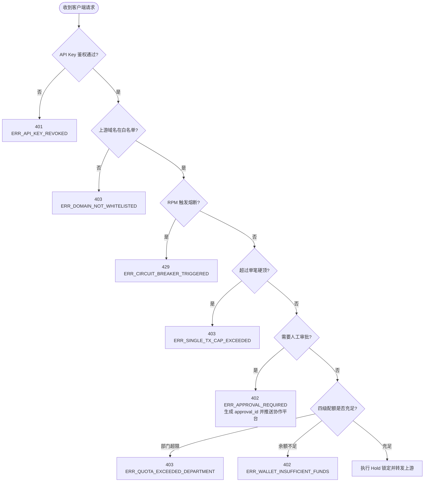

# 跨语言协议一致性与统一错误码规范

> **版本**：v2.0.0 (企业级跨语言一致性契约)  
> **状态**：**已定稿 (Approved Specification)**  
> **适用范围**：Python Client SDK、TypeScript SDK、Java SDK、Go Gateway 数据面与控制面

---

## 1. 目标与设计原则

为了确保多语言 SDK（Python、TypeScript、Java）与 Go 网关在协议解析、错误处理与拦截行为上具备 100% 的确定性与跨语言等价性，必须遵循以下核心原则：

1. **统一错误枚举与响应 Schema**：所有错误响应严格遵循统一的 JSON 格式，跨语言 SDK 解析出的错误枚举完全一致。
2. **两阶段 HTTP 402 交互与审批解挂**：针对人在回路（HITL）与超额风控，标准化 402 响应头与重试握手契约。
3. **零浮点数传输**：所有金额字段均以精确整数字符串或 64 位整数（`amount_base_units`）在网络中传输，严格杜绝浮点数精度漂移。

---

## 2. 标准 HTTP 交互与标头协议

### 2.1 标头契约 (Headers Specification)

| Header 名称 | 方向 | 格式与示例 | 说明 |
| :--- | :--- | :--- | :--- |
| `Authorization` | Client $\to$ Gateway | `Bearer apk_live_...` | Agent 身份鉴权 API Key |
| `X-AgentPay-Approval-Id` | Client $\to$ Gateway | `appr_01j7b8z4m0k9x8y1` | 审批通过后携带的解挂凭证单号 |
| `X-Langfuse-Trace-Id` | Client $\to$ Gateway | `trace_uuid...` | Langfuse 联合全链路追踪 Trace ID |
| `X-Langfuse-Span-Id` | Client $\to$ Gateway | `span_uuid...` | Langfuse 关联调用的当前 Span ID |
| `X-AgentPay-Intent-Id` | Gateway $\to$ Client | `pi_01j7b8z4m0k9x8y2` | 网关生成的唯一支付意图 ID |
| `X-AgentPay-Hold-Id` | Gateway $\to$ Client | `hld_01j7b8z4m0k9x8y3` | 资金冻结凭单 ID |
| `X-AgentPay-Cost-Base-Units` | Gateway $\to$ Client | `500000` (即 0.05 元) | 本次调用实际确扣金额微单位 |

### 2.2 标准错误响应格式

当请求被网关拒绝、限流或触发审批时，网关返回结构化 JSON：

```json
{
  "error": {
    "code": "ERR_APPROVAL_REQUIRED",
    "message": "本次调用金额超过免审阈值，已触发飞书/企业微信审批",
    "category": "HITL",
    "details": {
      "approval_id": "appr_01j7b8z4m0k9x8y1",
      "amount_base_units": 30000000,
      "currency": "CNY",
      "retry_after_seconds": 5
    }
  }
}
```

---

## 3. 统一错误码对照表

| 统一错误码 (`code`) | HTTP 状态码 | 类别 (`category`) | 语义与客户端处置策略 |
| :--- | :--- | :--- | :--- |
| `ERR_WALLET_INSUFFICIENT_FUNDS` | 402 | FINOPS | 租户钱包可用余额不足，通知财务充值 |
| `ERR_APPROVAL_REQUIRED` | 402 | HITL | 触发人工审批，SDK 自动挂起等待 |
| `ERR_APPROVAL_REJECTED` | 403 | HITL | 审批人明确驳回调用，任务中止 |
| `ERR_APPROVAL_EXPIRED` | 408 | HITL | 审批单超时未决议，自动失效 |
| `ERR_SINGLE_TX_CAP_EXCEEDED` | 403 | POLICY | 单笔请求金额超过硬顶上限，直接拦截 |
| `ERR_ROLLING_BUDGET_EXCEEDED` | 429 | POLICY | 智能体 24 小时累计预算超额，当日阻断 |
| `ERR_QUOTA_EXCEEDED_DEPARTMENT`| 403 | POLICY | 部门月度配额已耗尽，需部门主管申请追加 |
| `ERR_QUOTA_EXCEEDED_PROJECT` | 403 | POLICY | 项目组月度配额已耗尽，需调增配额 |
| `ERR_CIRCUIT_BREAKER_TRIGGERED`| 429 | POLICY | 命中 RPM 熔断器，判定死循环，强制掐断 |
| `ERR_NONCE_REPLAY` | 409 | SECURITY | 审批凭单或请求 Nonce 已被使用，防重放 |
| `ERR_DOMAIN_NOT_WHITELISTED` | 403 | SECURITY | 目标上游域名未在白名单中，拒绝转发 |
| `ERR_UPSTREAM_TIMEOUT` | 504 | GATEWAY | 上游模型响应超时，网关已原子解冻资金 |
| `ERR_API_KEY_REVOKED` | 401 | AUTH | API Key 已被管理员吊销或已过期 |

---

## 4. 判定决策流与优先级


