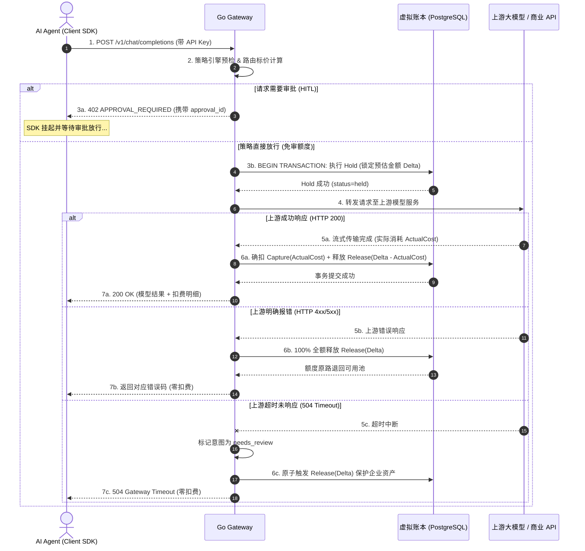

# 防悬挂三态状态机规范

> **版本**：v2.0.0 (企业级生产规范)  
> **状态**：**已定稿 (Approved Specification)**  
> **核心定位**：**企业级 AI 行为审计与资金防火墙网关 (AI Agent Gateway & FinOps)**  
> **适用范围**：AgentPay Go Gateway 数据面、控制面、虚拟账本引擎与离线对账调度器

---

## 1. 核心设计原则

在企业高并发与大语言模型流式调用中，网络超时、上游模型不可用是常态。若将业务意图、资金扣减与上游网络请求耦合在同一生命周期中，极易导致“请求超时但资金扣减”或“接口已返回但未记录扣费”等严重事故。

为此，AgentFinOps 严格执行**三条状态线正交解耦（Orthogonal Decoupling）**：

1. **三条状态线严格正交分离**：
   - **支付意图（PaymentIntent）**：业务层端到端请求生命周期（`created` $\to$ `challenged` $\to$ `authorized` $\to$ `completed`）；
   - **结算状态（Settlement）**：企业内部只追加虚拟账本的原子资金状态（`not_started` $\to$ `held` $\to$ `captured` $\to$ `released`）；
   - **履约状态（Fulfillment）**：下游模型与商业 API 接口的真实网络响应状态（`not_started` $\to$ `in_progress` $\to$ `succeeded` $\to$ `failed`）。
2. **两阶段防悬挂原子锁定（Hold $\to$ Capture $\to$ Release）**：
   - 转发上游前，必须在数据库事务中完成预估最大金额的 `Hold` 冻结；
   - 上游成功返回且流式响应结束，按真实 Token 消耗确扣 `Capture`，并原子 `Release` 剩余差额；
   - 若上游发生超时或 4xx/5xx 错误，100% 自动 `Release`，绝无资金悬挂。
3. **人在回路 (HITL) 挂起兼容**：
   - 超过阈值请求转入 `needs_review` / `challenged`，签发 `approval_id` 后返回 402，允许异步审批放行后重放。

---

## 2. 三维状态正交矩阵

```text
┌────────────────────────────────────────────────────────────────────────┐
│                        支付意图 (PaymentIntent)                        │
│   • created: 请求初次到达网关                                          │
│   • challenged: 已签发 402 Challenge (包含 approval_id 或配额挑战)    │
│   • authorized: 客户端携带合法凭证重试通过                             │
│   • completed: 扣费确权且上游履约成功 (终态)                           │
│   • rejected: 策略引擎阻断 / 超额被人工拒绝 (终态)                     │
│   • failed: 配额不足 / 系统级错误 (终态)                               │
│   • needs_review: 上游未知异常或挂起等待审批                           │
└───────────────────────────────────┬────────────────────────────────────┘
                                    │ 驱动与正交关联
                                    ▼
┌───────────────────────────────────┴────────────────────────────────────┐
│                        结算状态 (Settlement)                           │
│   • not_started: 尚未申请资金预留                                      │
│   • held: 预估最大金额已在虚拟账本中成功锁定 (Hold)                    │
│   • captured: 实际消耗金额已确认入账，写入不可变流水 (Capture)         │
│   • released: 预留额度已全额释放回可用余额池 (Release)                 │
│   • unknown: 扣费状态异常，需由日终平账器排查                          │
└───────────────────────────────────┬────────────────────────────────────┘
                                    │ 决定是否发起上游调用
                                    ▼
┌───────────────────────────────────┴────────────────────────────────────┐
│                        履约状态 (Fulfillment)                          │
│   • not_started: 尚未向下游商业模型或 API 发出网络调用                 │
│   • in_progress: 请求已转发，流式连接持续中                            │
│   • succeeded: 上游正常返回 HTTP 200 并传输完毕                        │
│   • failed: 上游返回 HTTP 4xx/5xx 或连接重置                           │
│   • unknown: 网关读取上游响应超时 (504 Timeout)                        │
└────────────────────────────────────────────────────────────────────────┘
```

---

## 3. 核心流转时序与异常恢复



---

## 4. 状态转移矩阵与约束表

### 4.1 支付意图转移表 (`PaymentIntent`)

| 当前状态 | 触发事件 | 目标状态 | 约束条件 |
| :--- | :--- | :--- | :--- |
| `created` | `policy_passed` | `authorized` | 免审额度，策略评估直接放行 |
| `created` | `approval_triggered` | `challenged` | 超过风控阈值，签发 402 挂起 |
| `challenged` | `approval_granted` | `authorized` | 负责人移动端点击批准 |
| `challenged` | `approval_rejected`| `rejected` | 负责人点击拒绝或审批单超时 |
| `authorized` | `settlement_captured`| `completed` | 账本确扣成功且上游履约成功 |
| `authorized` | `settlement_failed`| `failed` | 可用余额不足，冻结失败 |

### 4.2 结算状态转移表 (`Settlement`)

| 当前状态 | 触发事件 | 目标状态 | 说明 |
| :--- | :--- | :--- | :--- |
| `not_started` | `hold_reserve` | `held` | 数据库行级排他锁锁定预估额度 |
| `not_started` | `hold_insufficient` | `failed` | 钱包余额不足，拒绝透支 |
| `held` | `capture_success` | `captured` | 按真实消耗扣除，写入账本底账 |
| `held` | `release_success` | `released` | 调用失败或超时，原子全额解冻 |
| `held` | `system_panic` | `unknown` | 异常掉电或崩溃，交由离线对账巡检 |

---

## 5. 组合状态与运维处置矩阵

控制台根据 `(PaymentIntent, Settlement, Fulfillment)` 三元组计算面向财务与运维人员的派生状态：

| 结算状态 | 履约状态 | 运维宏观状态 | 业务语义与系统动作 |
| :--- | :--- | :--- | :--- |
| `held` | `in_progress` | `PROCESSING` | 请求正在上游执行，额度已安全冻结中 |
| `captured` | `succeeded` | `COMPLETED` | 正常成功调用，账务与履约完全闭环 |
| `released` | `failed` | `ROLLED_BACK` | 上游报错或超时，额度已 100% 自动解冻返还 |
| `held` | `failed` | `ROLLBACK_PENDING` | 上游明确失败，调度器正在异步执行解冻释放 |
| `unknown` | `unknown` | `RECONCILIATION_REQUIRED` | 网络与网关双向未知，由五重对账调度器核查平账 |
