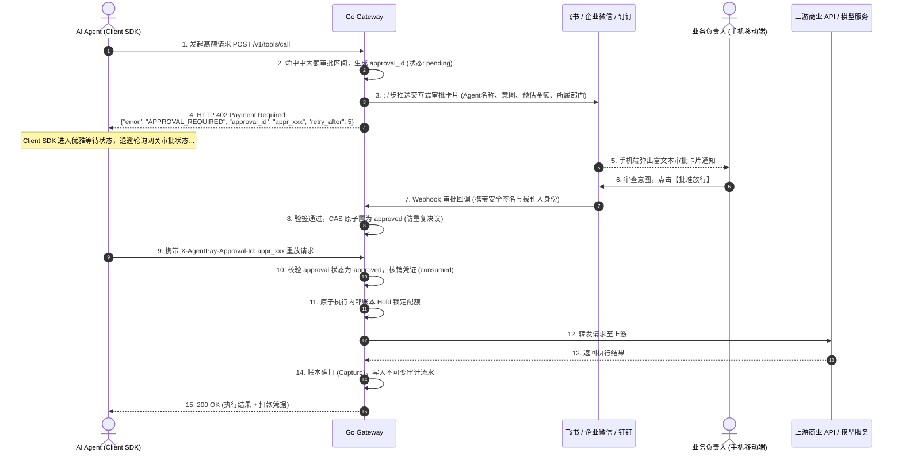

# 办公协同与人在回路 (HITL) 审批规范

> **版本**：v2.0.0 (企业级生产规范)  
> **状态**：**已定稿 (Approved Specification)**  
> **适用范围**：飞书/企业微信/钉钉审批机器人、HTTP 402 异步挂起引擎、移动端一键放行与客户端自动重放  
> **核心定位**：**企业级 AI 行为审计与资金防火墙网关 (AI Agent Gateway & FinOps)**

---

## 1. 痛点背景与设计目标

在真实企业生产场景中，大语言模型与自主智能体（AI Agent）接入高价值外部资源（如商业大模型、万方学术、企查查深度征信、短信核验通道）时，面临关键安全盾牌缺失：
1. **粗暴一刀切阻断**：传统策略引擎一旦检测到请求超过阈值，直接报错拒绝（`SINGLE_TX_CAP_EXCEEDED`），中断了正常的企业自动化业务流；
2. **长连接阻塞雪崩**：若在网关反向代理长连接中同步等待管理员人工审批，耗时通常长达数分钟，会导致网关 Goroutine 耗尽与 HTTP 连接池雪崩；
3. **缺乏移动办公协同**：企业负责人无法随时随地在手机端感知 Agent 的高额消费意图并快速决议。

为此，AgentFinOps 提出**三级风控梯度**与 **HTTP 402 异步挂起/解挂机制**。

---

## 2. 三级风控梯度 (Three-Tier Risk Policy)

网关根据请求预估金额 $\Delta$，原子判定执行策略：

$$\begin{cases}
\Delta \le \text{hitl\_threshold} & \Longrightarrow \text{小额免审：策略引擎毫秒级极速放行} \\
\text{hitl\_threshold} < \Delta \le \text{max\_tx\_cap} & \Longrightarrow \text{中大额审批：触发 402 异步挂起并推送飞书/企微卡片} \\
\Delta > \text{max\_tx\_cap} & \Longrightarrow \text{超大额阻断：单笔硬顶拒绝 (SINGLE\_TX\_CAP\_EXCEEDED)}
\end{cases}$$

- **免审额度 (`hitl_threshold`)**：例如 $\le 1.00$ 元，日常微额调用毫秒级放行；
- **审批区间 (`(hitl_threshold, max_tx_cap]`)**：例如 $1.00$ 元至 $100.00$ 元，触发人在回路；
- **单笔硬顶 (`max_tx_cap`)**：例如 $> 100.00$ 元，硬性拦截，防御极端 Prompt 注入。

---

## 3. 402 异步挂起与解挂时序 (Sequence Flow)



---

## 4. 协同审批卡片规范

### 4.1 飞书互动卡片 (Feishu CardKit 2.0)
卡片包含完整的审计上下文：
- **标题**：`⚠️ AI Agent 大额调用审批申请`
- **内容字段**：
  - **智能体标识**：`Coding Copilot (agent_01)`
  - **归属部门 / 项目**：`研发事业群 / 代码智能体项目组`
  - **调用意图 / 目标**：`查询全国企业深度工商涉诉征信报告`
  - **预估扣款金额**：`¥ 30.00 元`
  - **当前申请时间**：`2026-11-07 18:30:00`
  - **有效倒计时**：`剩余 300 秒自动失效`
- **操作按钮**：
  - 【批准放行】（绿色主按钮，附带安全二次确认）
  - 【驳回调用】（红色警告按钮，可填选驳回理由）

### 4.2 企业微信审批卡片 (WeCom Template Card)
通过企业微信应用消息推送模版卡片，支持移动端消息免密直按，并实时更新卡片按钮状态为“已批准”或“已驳回”，防止多人重复决议。

---

## 5. 安全决策与防重放机制 (Security & Idempotency)

1. **回调强制官方验签**：
   - 飞书：校验 `X-Lark-Signature` 与时间戳；
   - 企业微信：采用 `AES-CBC-256` 解密并验证回调 `MsgSignature`；
   - 校验请求时间戳差值 $\le 300$ 秒，防重放攻击。
2. **审批人 RBAC 权限严格校验**：
   - 检查点击审批人的工号/邮箱，必须具备该租户对应项目的 `owner` 或 `admin` 权限，普通员工无权放行。
3. **CAS 单次状态迁移 (Compare-And-Swap)**：
   - 审批单通过数据库条件更新：
     ```sql
     UPDATE ap_approval_request 
     SET status = 'approved', decided_by = $user_id, decided_at = CURRENT_TIMESTAMP 
     WHERE approval_id = $approval_id AND status = 'pending';
     ```
   - 杜绝网络重发或并发点击导致的重复决议。
4. **两阶段资金分离**：
   - 负责人点击“批准”仅签发授权许可，**不提前扣款**；
   - 客户端携带 `approval_id` 重放时，网关核销凭单并原子执行 `Hold -> Capture`，若客户端已超时放弃，不会产生任何误扣款。
